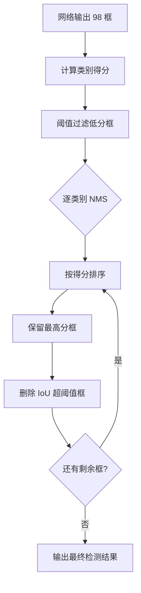

# YOLO原理分析：（YOLOv1）（端到端NMS后处理一次性输出）（解决重复检测框冗余问题）

## 前言

YOLOv1 在单次前向推理后输出全部预测框，并通过统一的**非极大值抑制**（NMS）后处理一次性筛选出最终检测结果。与两阶段方法中候选框生成与分类后再做 NMS 的多阶段流程不同，YOLOv1 将 NMS 整合为推理末端的标准化后处理步骤，配合置信度阈值过滤，实现了从原始图像到最终检测框的端到端输出。这一设计是单阶段检测"一次前向、一次后处理"范式的重要组成部分，也是后续所有 YOLO 版本沿用的标准推理流程。

## 背景：前一代的痛点

在两阶段检测方法中，后处理流程同样需要 NMS，但存在以下问题：

1. **流程割裂**：候选框生成、分类、NMS 分散在不同阶段，各阶段独立运行，整体推理延迟累积。
2. **框数量庞大**：候选区域方法动辄输出数千个候选框，NMS 需要在大量框之间逐对计算 IoU，计算开销不可忽视。
3. **后处理依赖外部模块**：NMS 通常作为独立的后处理工具存在，与网络训练目标不直接对齐。

YOLOv1 需要一种与单阶段回归框架匹配的简洁后处理方案。

## 原理详述

### 推理输出结构

YOLOv1 网络前向传播后，输出 $S \times S \times (B \times 5 + C)$ 的张量。展开后共有 $S \times S \times B$ 个预测边界框（YOLOv1 中为 $7 \times 7 \times 2 = 98$ 个框）。

每个预测框包含：
- 坐标 $(x, y, w, h)$
- 置信度 $\Pr(\text{object}) \times \text{IoU}$
- 条件类别概率 $p(\text{class}_i | \text{object})$

### 类别得分计算

每个预测框在每个类别上的最终得分为：

$$
\text{score}_{i,j} = p(\text{class}_i | \text{object}) \times \text{confidence}_j
$$

即条件类别概率与框置信度的乘积。这一得分同时反映了"框内是否有目标"以及"目标属于该类别的概率"。

### 两步后处理流程

**第一步：置信度阈值过滤**

设定一个置信度阈值（如 0.2），将所有得分低于该阈值的预测框直接丢弃。这一步可以快速去除大量背景框，显著减少后续 NMS 的计算量。

**第二步：逐类别 NMS**

对每个类别独立执行非极大值抑制：
1. 将该类别的所有剩余框按得分从高到低排序
2. 取得分最高的框作为保留框
3. 计算该框与其余所有框的 **IoU**，将 IoU 超过阈值（如 0.5）的框全部抑制（删除）
4. 在剩余框中重复步骤 2-3，直到所有框都被处理完毕

逐类别执行 NMS 的原因是：不同类别的框即使位置高度重叠，也应该同时保留（例如一个人骑着自行车，两个类别各自检出对应目标）。

### NMS 阈值的作用

NMS 阈值控制了"多近的框才算重复"：
- 阈值过低：容易误删相邻但不同的目标框
- 阈值过高：保留过多重复框，检测结果冗余

YOLOv1 沿用了当时常用的 IoU 阈值设置，后续版本在此基础上发展出 Soft-NMS、DIoU-NMS 等改进变体。

## 结构示意

```text
网络输出: 98 个预测框 (7×7×2)
        │
        ▼
┌──────────────────────┐
│ 计算每框每类得分      │
│ score = 类别概率 × 置信度 │
└──────────────────────┘
        │
        ▼
┌──────────────────────┐
│ 置信度阈值过滤        │
│ 丢弃 score < threshold │
└──────────────────────┘
        │
        ▼
┌──────────────────────┐
│ 逐类别执行 NMS        │
│                      │
│ for each class:      │
│   按得分排序          │
│   while 剩余框非空:   │
│     保留最高分框      │
│     删除 IoU>阈值的框 │
└──────────────────────┘
        │
        ▼
   最终检测结果列表
```



## 解决了什么问题

YOLOv1 的端到端 NMS 后处理针对前一代后处理流程的痛点做出了以下改进：

1. **简化后处理流程**：从网络输出到最终结果只需"阈值过滤 + NMS"两步，流程标准化、可复现。
2. **框数量可控**：网格划分使预测框数量固定为 $S \times S \times B$（仅 98 个），远少于两阶段方法的数千候选框，NMS 计算开销极低。
3. **与训练目标对齐**：置信度预测本身就编码了"是否含目标"的信息，后处理阈值与训练目标直接对应，无需额外校准。

## 效果与影响

这一后处理设计使 YOLOv1 的推理流水线极为简洁：输入图像 → 一次前向传播 → 阈值过滤 → 逐类别 NMS → 输出结果。整个流程没有任何独立的候选框生成步骤，推理延迟稳定可控。

后续 YOLO 系列版本虽在 NMS 策略上有所改进（如 Soft-NMS、DIoU-NMS 等），但"置信度阈值过滤 + 逐类别 NMS"的基本框架被完整保留，成为单阶段检测推理的标准范式。这种简洁高效的后处理也是 YOLO 系列能够实现实时推理速度的重要保障之一。


---

- 本博客采用生成式AI工具辅助完成撰写
- 本博客所有数据、架构、性能指标均为AI推演生成，不代表生产实践实测结果
- 本博客技术细节仅作为技术探索使用，不构成任何生产实践的指导建议
- 本博客作者不对直接或间接参考本博客开展生产实践所产生的后果负责


