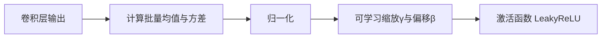

# YOLO原理分析：（YOLOv2）（Batch Normalization全面加入）（解决训练收敛慢与梯度波动问题）

## 前言

YOLOv2 在每一个**卷积层**后全面加入 **Batch Normalization**（批量归一化，BN）。这一改动看似常规，却带来了显著的精度提升与训练加速。Batch Normalization 通过对每个小批量的特征进行归一化，缓解了深层网络中的内部协变量偏移问题，允许使用更大的学习率、去除 Dropout 正则化、并显著加快收敛速度。在 YOLOv2 中，BN 的全面应用是精度提升的重要贡献因素之一，也成为后续所有 YOLO 版本的标准配置。

## 背景：前一代的痛点

YOLOv1 的网络训练存在以下问题：

1. **内部协变量偏移**：深层网络中，每一层的输入分布会随着前层参数更新而不断变化，迫使网络使用较小的学习率并精心初始化参数。
2. **梯度波动大**：使用 LeakyReLU 激活时，梯度在不同层之间波动较大，训练不稳定。
3. **依赖正则化手段**：YOLOv1 使用 Dropout 防止过拟合，但 Dropout 会增加训练时间并可能影响特征表达。

这些问题限制了网络深度的增加和训练效率的提升。

## 原理详述

### Batch Normalization 的基本原理

Batch Normalization 对每个特征通道在一个小批量（mini-batch）内进行归一化：

对于某一层的输出 $x$，批量归一化操作如下：

$$
\mu_B = \frac{1}{m} \sum_{i=1}^{m} x_i \quad \text{（批量均值）}
$$

$$
\sigma_B^2 = \frac{1}{m} \sum_{i=1}^{m} (x_i - \mu_B)^2 \quad \text{（批量方差）}
$$

$$
\hat{x}_i = \frac{x_i - \mu_B}{\sqrt{\sigma_B^2 + \epsilon}} \quad \text{（归一化）}
$$

$$
y_i = \gamma \hat{x}_i + \beta \quad \text{（缩放与偏移）}
$$

其中 $\gamma$ 和 $\beta$ 是可学习的参数，允许网络恢复最优的特征分布。

### 在 YOLOv2 中的应用位置

YOLOv2 在**每一个卷积层**之后都加入 Batch Normalization：

```text
Conv → Batch Normalization → LeakyReLU
```

而非仅在部分层使用。这种全面的 BN 应用带来了多重收益。

### BN 带来的具体改进

**1. 加速训练收敛**

归一化使每一层的输入分布保持稳定，网络不需要为适应分布变化而反复调整参数，收敛速度显著加快。

**2. 允许更大学习率**

BN 缓解了梯度消失/爆炸问题，使整个网络可以使用更大的学习率，训练更快。

**3. 去除 Dropout**

BN 本身具有正则化效果（批量内的噪声引入），因此 YOLOv2 可以移除 YOLOv1 中的 Dropout 层，简化网络结构的同时避免了 Dropout 对特征表达的干扰。

**4. 降低对初始化的敏感度**

归一化使得参数初始化不再那么关键，训练更加稳定。

### 推理阶段的 BN

推理时，批量均值和方差使用训练阶段累积的滑动平均值，而非当前输入的统计量。这样推理过程与批量大小无关，输出是确定的。

## 结构示意

```text
YOLOv1 某层:
  Conv → LeakyReLU → Dropout

YOLOv2 某层:
  Conv → Batch Norm → LeakyReLU
            │
            ├─ 批量均值归一化
            ├─ 批量方差归一化
            └─ γ, β 可学习缩放偏移

效果:
  ┌──────────────────────────┐
  │ ✅ 收敛速度加快           │
  │ ✅ 学习率可增大           │
  │ ✅ 移除 Dropout           │
  │ ✅ 训练更稳定             │
  │ ✅ 精度提升               │
  └──────────────────────────┘
```



## 解决了什么问题

Batch Normalization 全面加入针对 YOLOv1 训练中的痛点做出了以下改进：

1. **内部协变量偏移**：BN 使每层输入分布保持稳定，消除了深层网络训练的主要障碍。
2. **训练不稳定**：归一化后的梯度流动更健康，减少了梯度消失/爆炸风险。
3. **正则化依赖**：BN 自带正则化效果，替代了 Dropout，简化了网络结构。

## 效果与影响

在 YOLOv2 中，全面加入 Batch Normalization 后，mAP（mean Average Precision）相比 YOLOv1 有显著提升，同时训练时间缩短。这一改进的重要性不仅在于精度提升，更在于它确立了"Conv → BN → Activation"作为卷积网络的标准组件序列。后续 YOLOv3、YOLOv4、YOLOv5 全部沿用了这一模式，BN 已成为现代卷积神经网络不可或缺的基础组件。


---

- 本博客采用生成式AI工具辅助完成撰写
- 本博客所有数据、架构、性能指标均为AI推演生成，不代表生产实践实测结果
- 本博客技术细节仅作为技术探索使用，不构成任何生产实践的指导建议
- 本博客作者不对直接或间接参考本博客开展生产实践所产生的后果负责


