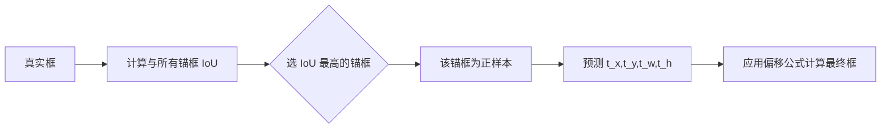

# YOLO原理分析：（YOLOv2）（anchor box先验框机制引入）（解决边界框预测不稳定问题）

## 前言

YOLOv2（又称 YOLO9000）首次将 **anchor box**（锚框/先验框）机制引入 YOLO 框架。此前 YOLOv1 直接回归边界框的绝对坐标与宽高，导致框形状预测不稳定、难以适配多尺度目标。YOLOv2 借鉴两阶段检测中的锚框思想，预设一组具有代表性的边界框形状，网络只需预测相对于锚框的偏移量与置信度，大幅降低了回归难度。这一转变使 YOLO 从"直接预测绝对坐标"演进为"基于先验框的偏移预测"，是单阶段检测精度提升的关键一步。

## 背景：前一代的痛点

YOLOv1 直接预测边界框的 $(x, y, w, h)$ 四个绝对坐标值，存在以下问题：

1. **回归空间过大**：网络需要从零开始学习各种目标的框形状，训练初期梯度波动大，收敛慢。
2. **形状适应性差**：每个 grid cell 仅预测 2 个框，且没有形状先验，难以覆盖宽高比差异很大的目标。
3. **定位精度受限**：直接预测绝对坐标对网络的回归能力要求很高，尤其在小目标上误差显著。

两阶段检测方法中广泛使用的 **anchor box** 机制提供了一种思路：预设多种形状的参考框，网络只需学习偏移量，回归难度大幅降低。YOLOv2 将这一思路引入单阶段框架。

## 原理详述

### 从直接回归到偏移预测

引入 anchor box 后，边界框预测方式发生根本性变化：

**YOLOv1 的方式**：网络直接输出 $(x, y, w, h)$ 的绝对值。

**YOLOv2 的方式**：网络预测相对于预设锚框的偏移量：

$$
\begin{aligned}
b_x &= \sigma(t_x) + c_x \\
b_y &= \sigma(t_y) + c_y \\
b_w &= p_w e^{t_w} \\
b_h &= p_h e^{t_h}
\end{aligned}
$$

其中：
- $(c_x, c_y)$：grid cell 左上角坐标
- $(p_w, p_h)$：锚框的宽和高
- $(t_x, t_y, t_w, t_h)$：网络预测的偏移量
- $\sigma(\cdot)$：sigmoid 函数，将中心偏移约束在 $[0, 1]$
- $(b_x, b_y, b_w, b_h)$：最终输出的边界框

### 锚框的作用

锚框本质上是一组**形状先验**：
- 每个 grid cell 不再只预测 2 个框，而是对应 $k$ 个锚框（YOLOv2 中 $k=5$）
- 每个锚框有独立的宽高形状，覆盖不同宽高比的目标
- 网络只需学习"在这个锚框基础上怎么调整"，而不是从零开始预测

### 输出维度变化

引入 anchor box 后，输出张量结构发生变化：

- YOLOv1：$S \times S \times (B \times 5 + C)$，每格 $B=2$ 个框
- YOLOv2：$S \times S \times (A \times (5 + C))$，每格 $A=5$ 个锚框

每个锚框预测：$(t_x, t_y, t_w, t_h, \text{confidence}) + C$ 个类别概率。

### 正样本匹配

引入锚框后，正样本分配规则也相应调整：
- 对于每个真实框，计算它与所有锚框的 **IoU**
- IoU 最高的那个锚框负责预测该真实框
- 这与 YOLOv1 中"中心点所在网格负责"的规则不同，改为基于形状匹配

### 全卷积化

为配合锚框机制，YOLOv2 移除了 YOLOv1 中的全连接层，改为全卷积网络，使用**卷积层**+**全局池化**输出预测，使网络可以接受不同尺寸的输入，支持多尺度训练。

## 结构示意

```text
YOLOv1: 直接预测绝对坐标
  grid cell → 输出 (x, y, w, h)
  x, y, w, h 都是绝对数值，网络从零学习

YOLOv2: 基于锚框的偏移预测
  ┌─────────────────────────┐
  │ 预设 5 个锚框形状:        │
  │  ● 窄高型                │
  │  ● 方正型                │
  │  ● 宽扁型                │
  │  ● 中等型                │
  │  ● 其他型                │
  └─────────────────────────┘
          │
          ▼
  grid cell → 每个锚框预测:
    t_x, t_y (中心偏移, sigmoid)
    t_w, t_h (宽高缩放, 指数)
    confidence
    类别概率
          │
          ▼
  最终框 = 锚框形状 + 偏移调整
```



## 解决了什么问题

anchor box 机制针对 YOLOv1 直接回归的缺陷做出了以下改进：

1. **降低回归难度**：从"预测绝对坐标"变为"预测相对于先验框的偏移量"，回归空间大幅缩小，训练更稳定。
2. **提升形状适应性**：5 个预设锚框覆盖不同宽高比，网络能更好地适配形状各异的目标。
3. **提高召回率**：更多的锚框数量 + 形状先验，使更多真实目标能被匹配到合适的锚框，检测召回率显著提升。

## 效果与影响

引入 anchor box 后，YOLOv2 的召回率相比 YOLOv1 大幅提升，虽然精度略有变化，但整体检测性能显著改善。更重要的是，锚框机制成为后续 YOLOv3、YOLOv4、YOLOv5 乃至绝大多数单阶段检测框架的标准组件。从"直接回归"到"锚框偏移预测"的转变，是单阶段检测从"能用"走向"好用"的关键一步。


---

- 本博客采用生成式AI工具辅助完成撰写
- 本博客所有数据、架构、性能指标均为AI推演生成，不代表生产实践实测结果
- 本博客技术细节仅作为技术探索使用，不构成任何生产实践的指导建议
- 本博客作者不对直接或间接参考本博客开展生产实践所产生的后果负责

