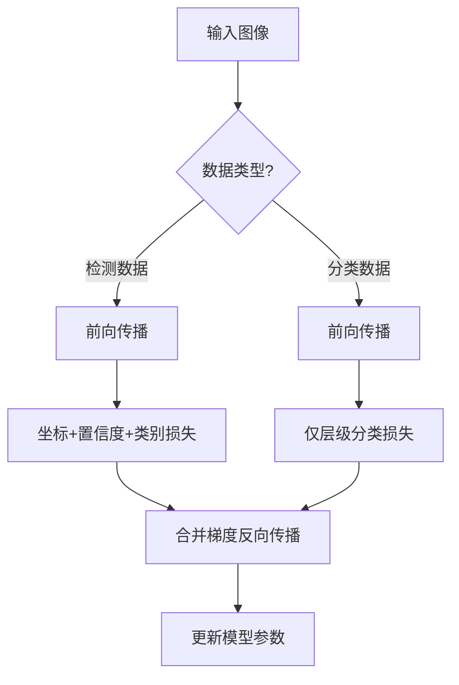

# YOLO原理分析：（YOLOv2）（联合检测与词树分类YOLO9000）（解决检测类别扩展与数据稀缺问题）

## 前言

YOLOv2 的姊妹工作 **YOLO9000** 提出了联合训练检测与分类数据的方法，利用分类数据集的丰富类别扩展检测器的可识别范围。其核心创新是构建**词树**（WordTree）层级结构，将检测数据集与分类数据集的类别体系统一为一棵层级分类树，通过联合优化分类损失与检测损失，使单一模型能够检测超过 9000 个类别。这一工作首次证明了检测与分类数据可以联合训练，为解决检测类别标注稀缺问题提供了全新思路。

## 背景：前一代的痛点

目标检测面临一个根本矛盾：

1. **检测标注昂贵**：检测数据需要标注边界框，标注成本高，类别数量有限（通常只有几十到上百类）。
2. **分类数据丰富**：分类数据集有海量图像和数千个类别，但没有边界框标注。
3. **类别扩展困难**：想让检测器识别新类别，就需要重新标注边界框数据，成本极高。

如何利用分类数据的海量类别来扩展检测器的识别范围，是一个长期难题。

## 原理详述

### 词树（WordTree）层级结构

YOLO9000 的核心设计是构建一棵词树：

- 树的叶节点是具体的类别（如"金毛寻回犬"、"泰迪犬"）
- 树的中间节点是抽象的上位概念（如"犬"、"哺乳动物"、"动物"）
- 树的根节点是最抽象的概念（如"物体"）

词树将不同数据集的类别体系整合到同一棵层级树中：
- 检测数据集的类别（有边界框标注）作为树中的部分节点
- 分类数据集的类别（只有图像级标签）作为树中的其他节点
- 两个数据集的类别通过共享的上位概念连接起来

### 层级分类预测

在词树结构下，分类预测不再是平级的多分类，而是沿树的层级逐层预测：

对于一个输入目标，网络预测：
- 根节点到叶节点路径上每一层级的条件概率
- 即：$p(\text{节点} | \text{父节点})$

最终某个叶节点类别的概率为路径上所有条件概率的乘积：

$$
p(\text{金毛犬}) = p(\text{动物}) \times p(\text{犬} | \text{动物}) \times p(\text{金毛} | \text{犬})
$$

这种层级分类方式使得不同粒度的类别可以共存于同一模型中。

### 联合训练策略

**检测数据集的训练**：
- 使用标准的 YOLO 检测损失（坐标、置信度、类别）
- 类别预测在词树对应节点上计算分类损失

**分类数据集的训练**：
- 没有边界框，只有图像级类别标签
- 将标签映射到词树中的对应节点
- 沿该节点到根节点的路径计算层级分类损失
- 不计算坐标损失与置信度损失

**训练流程**：
- 每个训练批次混合检测数据与分类数据
- 检测数据前向传播 → 计算检测损失（完整损失）
- 分类数据前向传播 → 只计算分类损失（部分损失）
- 反向传播时合并两类损失的梯度

### 损失函数设计

对于检测数据：
$$
L_{\text{det}} = L_{\text{coord}} + L_{\text{conf}} + L_{\text{cls}}^{\text{det}}
$$

对于分类数据：
$$
L_{\text{cls}}^{\text{classify}} = \text{沿词树路径的层级分类损失}
$$

总损失：
$$
L = L_{\text{det}} + \lambda \cdot L_{\text{cls}}^{\text{classify}}
$$

### YOLO9000 的能力

通过联合训练，YOLO9000 模型可以同时：
- 在检测数据集中训练的类别上输出边界框检测
- 在分类数据集中训练的类别上输出分类标签（但不一定有精确边界框）
- 总共支持超过 9000 个类别的识别

## 结构示意

```text
                    物体 (根)
                   /    |    \
              动物   植物   交通工具
             / \          / | \
          犬  猫       汽车 火车 飞机
         / \  ...
    金毛 泰迪 ...
      │
  词树叶节点
      │
┌─────┴──────────────┐
│ 检测数据集类别:     │
│  → 有边界框标注      │
│  → 计算完整检测损失  │
├──────────────────────┤
│ 分类数据集类别:     │
│  → 只有图像标签      │
│  → 只计算分类损失    │
└──────────────────────┘
```



## 解决了什么问题

YOLO9000 的联合训练方法针对检测类别扩展的痛点做出了以下改进：

1. **扩展可识别类别**：利用分类数据集的数千类别，检测器可识别类别从几十类扩展到 9000+ 类。
2. **缓解标注稀缺**：分类数据无需边界框标注即可参与训练，大幅扩充了可用训练数据。
3. **层级分类统一**：词树结构将不同粒度的类别体系统一，模型可以同时输出不同抽象层级的预测。

## 效果与影响

YOLO9000 是首个实现单模型检测 9000+ 类别的实时检测器。虽然其在纯检测精度上不及专门的检测器，但它证明了检测与分类数据联合训练的可行性，开辟了"利用海量分类数据增强检测模型"的研究方向。这一思想后来被后续工作继承发展，包括弱监督检测、半监督检测等方向。词树层级分类的设计也启发了后续的层级检测体系研究。


---

- 本博客采用生成式AI工具辅助完成撰写
- 本博客所有数据、架构、性能指标均为AI推演生成，不代表生产实践实测结果
- 本博客技术细节仅作为技术探索使用，不构成任何生产实践的指导建议
- 本博客作者不对直接或间接参考本博客开展生产实践所产生的后果负责

