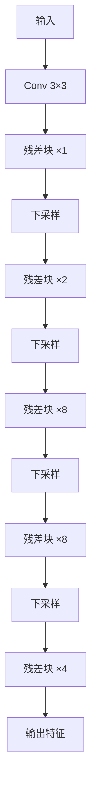

# YOLO原理分析：（YOLOv3）（Darknet-53残差主干网络）（解决深层网络训练退化问题）

## 前言

YOLOv3 提出了 **Darknet-53** 主干网络，引入**残差连接**（residual connection）构建 53 层卷积网络。此前 YOLOv2 的主干网络较浅，特征表达能力受限。Darknet-53 通过残差块堆叠实现了深层网络的稳定训练，在保持推理速度的同时显著提升了特征提取能力。这一主干网络设计使 YOLOv3 在精度上相比前一代有大幅提升，也是 YOLO 系列首次采用深层残差骨干架构。

## 背景：前一代的痛点

YOLOv2 使用的主干网络相对较浅，存在以下问题：

1. **特征表达能力不足**：网络层数有限，难以提取抽象、语义丰富的深层特征。
2. **加深网络困难**：随着网络层数增加，梯度消失/爆炸问题加剧，训练难以收敛。
3. **精度瓶颈**：浅主干限制了检测精度的上限，尤其是在复杂场景下。

如何在不过度增加计算量的前提下加深网络、增强特征提取能力，是 YOLOv3 需要解决的核心问题。

## 原理详述

### Darknet-53 的结构

Darknet-53 由 53 个卷积层组成，因此得名。其核心组件是**残差块**（residual block）：

每个残差块包含：
1. $1 \times 1$ 卷积：压缩通道数
2. $3 \times 3$ 卷积：提取特征，通道数恢复
3. **跳跃连接**（skip connection）：输入直接加到输出上

残差块的数学表达：

$$
y = F(x) + x
$$

其中 $F(x)$ 是残差映射（两层卷积），$x$ 是输入捷径连接。

### 网络整体结构

Darknet-53 的层级结构：

```text
输入 (416×416×3)
  │
  Conv 3×3, 32 filters
  │
  ├─ 残差块 ×1 (64通道)
  │
  ├─ 残差块 ×2 (128通道)
  │
  ├─ 残差块 ×8 (256通道)
  │
  ├─ 残差块 ×8 (512通道)
  │
  ├─ 残差块 ×4 (1024通道)
  │
  全局平均池化
  全连接分类层
```

总层数：$1 + (1+1) + 2\times(1+1) + 8\times(1+1) + 8\times(1+1) + 4\times(1+1) = 53$

### 下采样方式

Darknet-53 不使用**最大池化**，而是通过步长为 2 的卷积进行下采样：

- 每次下采样：卷积步长 = 2，特征图尺寸减半
- 通道数：每次下采样后通道数翻倍

这种全卷积下采样方式避免了池化层带来的信息损失。

### Batch Normalization 与 LeakyReLU

Darknet-53 延续了 YOLOv2 的设计：
- 每个卷积层后接 **Batch Normalization**
- 使用 LeakyReLU 激活函数（负斜率 0.1）

### 残差连接的作用

残差连接解决了深层网络训练退化问题：

1. **梯度直通**：跳跃连接为梯度提供了直接回传路径，缓解梯度消失。
2. **恒等映射**：网络只需学习残差 $F(x) = y - x$，学习难度降低。
3. **深度可扩展**：可以堆叠数十层而不会出现性能退化。

## 结构示意

```text
残差块结构:
┌─────────────────────┐
│   输入 x             │
│   ┌───────────┐    │
│   │ 1×1 Conv   │    │
│   │ BN + Leaky │    │
│   └─────┬─────┘    │
│         ▼           │
│   ┌───────────┐    │
│   │ 3×3 Conv   │    │
│   │ BN + Leaky │    │
│   └─────┬─────┘    │
│         │ F(x)     │
│         + ◄── 捷径 │
│         │           │
│         ▼           │
│   输出 y = F(x)+x   │
└─────────────────────┘

Darknet-53 整体:
  416×416
    ↓ Conv
  208×208 (64ch)  ← 1个残差块
    ↓ stride-2 Conv
  104×104 (128ch) ← 2个残差块
    ↓ stride-2 Conv
   52×52  (256ch) ← 8个残差块
    ↓ stride-2 Conv
   26×26  (512ch) ← 8个残差块
    ↓ stride-2 Conv
   13×13  (1024ch)← 4个残差块
```



## 解决了什么问题

Darknet-53 残差主干针对前一代主干网络的痛点做出了以下改进：

1. **深层网络可训练**：残差连接使 53 层网络能够稳定训练，不再受梯度消失困扰。
2. **特征表达增强**：更深的网络 + 更多通道，特征提取能力显著提升。
3. **速度与精度平衡**：Darknet-53 在保持较高推理速度的同时达到了更强的特征表达，平衡了精度与效率。

## 效果与影响

Darknet-53 使 YOLOv3 的 mAP 相比 YOLOv2 有显著提升，尤其是在中小目标上的改善明显。这一主干设计证明了残差结构可以有效提升单阶段检测器的特征提取能力。后续 YOLOv4 的 CSPDarknet53 正是在 Darknet-53 的基础上引入 CSP（跨阶段局部连接）思想进一步优化，Darknet-53 的残差块设计成为后续主干网络的基础组件。


---

- 本博客采用生成式AI工具辅助完成撰写
- 本博客所有数据、架构、性能指标均为AI推演生成，不代表生产实践实测结果
- 本博客技术细节仅作为技术探索使用，不构成任何生产实践的指导建议
- 本博客作者不对直接或间接参考本博客开展生产实践所产生的后果负责

