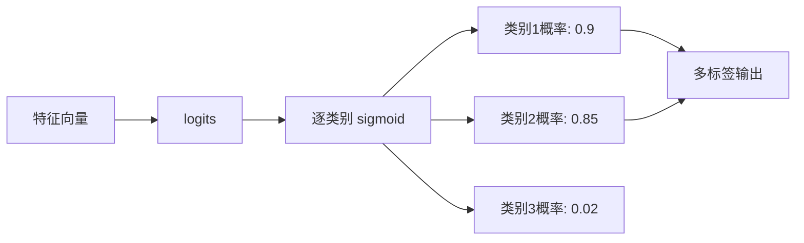

# YOLO原理分析：（YOLOv3）（logistic分类器替代softmax）（解决多标签目标分类表达受限问题）

## 前言

YOLOv3 将类别预测从 **softmax** 分类器改为独立的 **logistic 分类器**（sigmoid + 二值交叉熵）。此前 YOLOv2 使用 softmax 对所有类别做互斥分类，假设每个目标只属于一个类别。但在实际场景中，一个目标可能同时属于多个类别（如"行人"和"女人"、"车辆"和"汽车"）。logistic 分类器允许多标签预测，使模型能够处理类别重叠的复杂场景，这一改动看似简单，却大幅扩展了检测模型的适用范围。

## 背景：前一代的痛点

YOLOv1 和 YOLOv2 都使用 softmax 层进行类别预测：

$$
p_i = \frac{e^{z_i}}{\sum_{j=1}^{C} e^{z_j}}
$$

softmax 的特点是所有类别概率之和为 1，即**类别互斥**。这带来了问题：

1. **多标签场景受限**：如果一个目标同时属于多个类别（如数据集中有"女人"和"行人"两个类别，而一个女性行人同时属于两者），softmax 无法正确建模这种重叠关系。
2. **层级类别不兼容**：当类别体系存在层级结构（如"狗"包含"金毛"和"泰迪"）时，softmax 的互斥假设会导致层级分类无法正确训练。
3. **细粒度分类困难**：对于存在父子类别的数据集，softmax 会把互斥性强加给本不互斥的类别。

## 原理详述

### 从 softmax 到 logistic

YOLOv3 不再使用 softmax，而是对每个类别独立使用 sigmoid 函数：

$$
p_i = \sigma(z_i) = \frac{1}{1 + e^{-z_i}}
$$

每个类别的输出是一个独立的概率值，取值在 $[0, 1]$ 之间，类别之间互不影响。

### 损失函数变化

类别损失从 softmax 交叉熵改为**二值交叉熵**（binary cross-entropy）：

$$
L_{\text{cls}} = -\sum_{i=1}^{C} \left[ y_i \log(p_i) + (1 - y_i) \log(1 - p_i) \right]
$$

其中 $y_i \in \{0, 1\}$ 是第 $i$ 类的真实标签，$p_i$ 是预测概率。

### 多标签预测能力

使用 logistic 分类器后，一个预测框可以同时输出多个类别的高概率：

```text
示例: 一个女性行人的检测框
  softmax 时代:
    p(行人) = 0.7
    p(女人) = 0.2
    p(汽车) = 0.05
    ...所有类别概率之和 = 1.0
    → 只能选概率最高的"行人"

  logistic 时代:
    p(行人) = 0.9  ✓
    p(女人) = 0.85 ✓
    p(汽车) = 0.02
    ...各概率独立
    → 可以同时输出"行人"和"女人"两个标签
```

### 阈值化推理

推理时，对每个类别的 sigmoid 输出设置一个置信度阈值（如 0.5）：
- 超过阈值的类别即为该检测框的预测类别
- 一个框可以输出多个类别标签

### 为什么不用 softmax

YOLOv3 选择 logistic 分类器的原因：

1. **类别重叠场景**：真实世界中一个目标可以同时属于多个类别。
2. **层级数据集兼容**：在扩展到更多类别（如 YOLO9000 的词树结构）时，层级分类需要独立的类别预测。
3. **更灵活的分类体系**：不假设类别互斥，适配更广泛的数据集类型。

## 结构示意

```text
softmax 分类器 (YOLOv1/v2):
  预测框特征
      │
      ▼
  ┌─────────┐
  │ 全连接   │
  │ logits   │
  └────┬────┘
       ▼
  ┌─────────┐
  │ softmax │ ← 所有类别互斥, 和为1
  └────┬────┘
       ▼
  输出: 每个类别一个概率, 和=1

logistic 分类器 (YOLOv3):
  预测框特征
      │
      ▼
  ┌─────────┐
  │ 卷积层   │
  │ logits   │
  └────┬────┘
       ▼
  ┌─────────┐
  │ sigmoid │ ← 每个类别独立, 互不影响
  │ (逐类)   │
  └────┬────┘
       ▼
  输出: 每个类别独立概率, 可同时为多个高
```



## 解决了什么问题

logistic 分类器替代 softmax 针对前一代分类方式的缺陷做出了以下改进：

1. **多标签支持**：一个目标可以同时属于多个类别，适配类别重叠的真实场景。
2. **层级分类兼容**：不再强制类别互斥，支持层级化的类别体系。
3. **扩展灵活**：新增类别时不需要重新调整 softmax 的全局归一化，训练更灵活。

## 效果与影响

这一改动虽小，但使 YOLOv3 的分类能力更加贴合实际场景。在 COCO 这类类别相对独立的数据集上，logistic 与 softmax 的效果差异不大，但在存在类别重叠或层级关系的数据集上，logistic 分类器展现出明显优势。后续 YOLOv4、YOLOv5 全部沿用了 logistic 分类器（即二元交叉熵损失），这一选择已成为现代检测器的标准配置。


---

- 本博客采用生成式AI工具辅助完成撰写
- 本博客所有数据、架构、性能指标均为AI推演生成，不代表生产实践实测结果
- 本博客技术细节仅作为技术探索使用，不构成任何生产实践的指导建议
- 本博客作者不对直接或间接参考本博客开展生产实践所产生的后果负责

