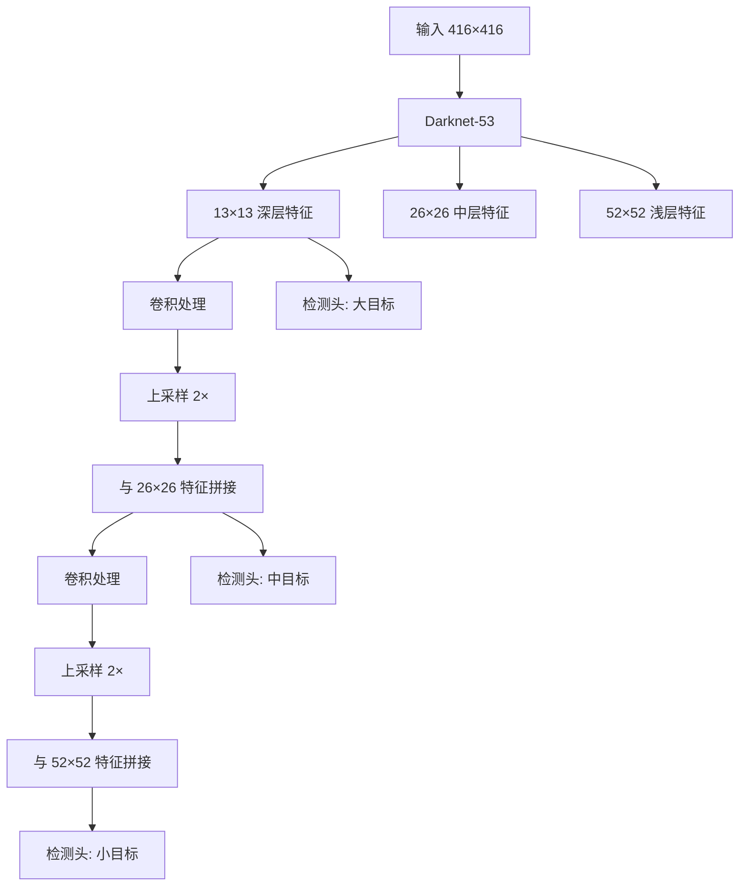

# YOLO原理分析：（YOLOv3）（三尺度特征金字塔多尺度预测）（解决多尺寸目标漏检问题）

## 前言

YOLOv3 提出了**三尺度特征金字塔预测**机制，在三个不同分辨率的特征图上分别预测边界框。此前 YOLOv2 仅在单一尺度特征图上检测，对小目标和大目标的适应性都有限。YOLOv3 借鉴 **FPN**（特征金字塔网络）的思想，将深层语义特征上采样后与浅层高分辨率特征拼接，在三个尺度上独立检测，显著提升了对不同尺寸目标的检测能力。这一设计是 YOLOv3 精度大幅提升的核心原因之一，也成为后续 YOLO 版本的标准配置。

## 背景：前一代的痛点

YOLOv2 仅在一个尺度的特征图（如 $13 \times 13$）上做预测，存在以下问题：

1. **小目标漏检**：$13 \times 13$ 的特征图经过 32 倍下采样，小目标在特征图上仅占 1-2 个像素，极易漏检。
2. **大目标定位不准**：单一尺度的感受野有限，对大目标的边界回归不够精确。
3. **特征利用率低**：浅层高分辨率特征与深层低分辨率特征各自为政，没有充分融合。

## 原理详述

### 三尺度输出设计

YOLOv3 在三个不同大小的特征图上分别做预测：

| 尺度 | 特征图尺寸 | 下采样倍数 | 适合检测的目标大小 |
|------|-----------|-----------|------------------|
| 大尺度（浅层高分辨率） | $52 \times 52$ | 8× | 小目标 |
| 中尺度 | $26 \times 26$ | 16× | 中等目标 |
| 小尺度（深层低分辨率） | $13 \times 13$ | 32× | 大目标 |

每个尺度上，每个 grid cell 预测 3 个 **anchor box**，共 $3 \times 3 = 9$ 个锚框分配到三个尺度上。

### 特征金字塔融合路径

YOLOv3 的特征融合采用自上而下的路径：

**自下而上（主干前向）**：
- Darknet-53 输出三个层级的特征：$52 \times 52$、$26 \times 26$、$13 \times 13$

**自上而下（特征融合）**：
1. 最深层 $13 \times 13$ 特征经过卷积处理后，上采样 2 倍得到 $26 \times 26$
2. 与主干中对应 $26 \times 26$ 的浅层特征拼接（concat）
3. 拼接后的特征再经过卷积处理，上采样 2 倍得到 $52 \times 52$
4. 与主干中对应 $52 \times 52$ 的更浅层特征拼接

### 上采样与拼接

上采样使用**最近邻上采样**（nearest neighbor upsampling），不增加可学习参数。拼接在通道维度进行：

$$
F_{\text{fuse}} = \text{Concat}(F_{\text{up}}, F_{\text{skip}})
$$

拼接后，特征图同时具有：
- 深层上采样带来的强语义信息
- 浅层跳跃连接带来的高分辨率细节

### 预测头

每个融合后的特征图后接若干卷积层组成的检测头，输出：

$$
S \times S \times (3 \times (5 + C))
$$

其中 $S$ 为特征图尺寸，$3$ 为每格锚框数，$C$ 为类别数。

### 锚框分配

9 个维度聚类得到的锚框按大小分配到三个尺度：
- 大尺度特征图（$52 \times 52$）→ 分配 3 个小锚框
- 中尺度特征图（$26 \times 26$）→ 分配 3 个中等锚框
- 小尺度特征图（$13 \times 13$）→ 分配 3 个大锚框

## 结构示意

```text
主干网络 Darknet-53:

  输入 416×416
    │
    ├──→ 52×52 特征 (浅层, 高分辨率) ──────┐
    │                                        │ concat
    ├──→ 26×26 特征 (中层) ──────┐          │
    │                             │ concat    │
    └──→ 13×13 特征 (深层, 低分辨率)         │
         │                                   │
         ▼                                   │
      卷积处理                                │
         │                                   │
         ▼ 上采样 ×2                          │
      26×26 ────────────────────────────────┘
         │
      卷积处理
         │
         ▼ 上采样 ×2
      52×52 ─────────────────────────────────→ 输出检测

三个输出尺度:
  13×13 × (3×(5+C))  → 检测大目标
  26×26 × (3×(5+C))  → 检测中目标
  52×52 × (3×(5+C))  → 检测小目标
```



## 解决了什么问题

三尺度特征金字塔预测针对 YOLOv2 单尺度检测的缺陷做出了以下改进：

1. **小目标漏检**：$52 \times 52$ 高分辨率特征图专门检测小目标，小目标不再被压缩到 1-2 个像素。
2. **大目标精度**：$13 \times 13$ 深层特征感受野大，适合检测大目标的整体轮廓。
3. **深浅特征融合**：自上而下的上采样+拼接路径，让深层语义信息传递到浅层，提升各尺度的分类精度。

## 效果与影响

三尺度预测是 YOLOv3 精度大幅提升的最主要贡献因素。在 COCO 数据集上，YOLOv3 对小目标的检测精度相比 YOLOv2 有质的飞跃。这一设计确立了"多尺度特征融合 + 多尺度检测头"作为现代检测器的标准范式，后续 YOLOv4 的 PANet、YOLOv5 的多尺度预测都延续了这一思路，并在此基础上增加了自下而上的路径聚合。

---

- 本博客采用生成式AI工具辅助完成撰写
- 本博客所有数据、架构、性能指标均为AI推演生成，不代表生产实践实测结果
- 本博客技术细节仅作为技术探索使用，不构成任何生产实践的指导建议
- 本博客作者不对直接或间接参考本博客开展生产实践所产生的后果负责

