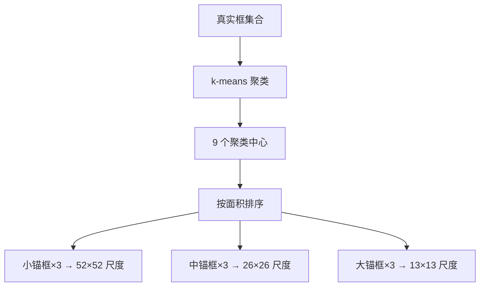

# YOLO原理分析：（YOLOv3）（九锚框维度先验跨尺度分配）（解决人工设计先验框匹配度不足问题）

## 前言

YOLOv3 将锚框数量从 YOLOv2 的 5 个增加到 9 个，并通过 **k-means 维度聚类**在数据集上自动学习锚框形状，再将 9 个锚框按大小分配到三个预测尺度上。此前 YOLOv2 的 5 个锚框由人工设计或简单聚类得到，形状覆盖有限，与真实目标的匹配度不高。YOLOv3 的 9 个聚类锚框 + 跨尺度分配机制，使先验框形状更加贴合数据分布，每个尺度都有适合其分辨率的锚框，显著提升了检测精度。

## 背景：前一代的痛点

YOLOv2 使用 5 个锚框，存在以下问题：

1. **锚框数量少**：5 个形状难以覆盖数据集中目标的宽高比多样性。
2. **人工设计局限**：锚框形状依赖经验设计或少量聚类，与真实目标形状匹配度不高。
3. **尺度不匹配**：所有锚框在同一尺度特征图上使用，没有按目标大小区分。

## 原理详述

### 维度聚类方法

YOLOv3 沿用 YOLOv2 提出的 k-means 维度聚类方法，但聚类数量从 5 增加到 9：

**聚类距离度量**：

聚类时不使用欧氏距离，因为大框的误差天然大于小框。采用基于 **IoU** 的距离度量：

$$
d(\text{box}, \text{centroid}) = 1 - \text{IoU}(\text{box}, \text{centroid})
$$

这样无论框大小，距离度量都是相对的，聚类结果更合理。

**聚类流程**：
1. 提取训练集中所有真实框的宽高
2. 随机初始化 9 个聚类中心
3. 计算每个真实框与 9 个中心的 IoU 距离
4. 将每个框分配给距离最近的中心
5. 更新每个聚类中心为该簇所有框的平均值
6. 重复 3-5 直到收敛

### 九个锚框的分配

聚类得到 9 个锚框后，按宽高面积从小到大排序，平均分配到三个尺度：

```text
9 个锚框 (按面积从小到大):
  小锚框 ×3  → 分配给 52×52 高分辨率特征图 (检测小目标)
  中锚框 ×3  → 分配给 26×26 中分辨率特征图 (检测中目标)
  大锚框 ×3  → 分配给 13×13 低分辨率特征图 (检测大目标)
```

### 为什么这样分配

- **高分辨率特征图**（$52 \times 52$）感受野小，适合检测小目标，配小锚框
- **中分辨率特征图**（$26 \times 26$）感受野中等，配中等锚框
- **低分辨率特征图**（$13 \times 13$）感受野大，适合检测大目标，配大锚框

这种"尺度-锚框"匹配使每个尺度的先验框与该尺度负责的目标大小相匹配。

### 输出维度变化

每个尺度特征图上，每个 grid cell 预测 3 个锚框：

$$
S \times S \times 3 \times (5 + C)
$$

三个尺度总输出：
- $52 \times 52 \times 3 \times (5 + C)$
- $26 \times 26 \times 3 \times (5 + C)$
- $13 \times 13 \times 3 \times (5 + C)$

### 锚框的作用再回顾

锚框作为形状先验：
- 网络预测相对于锚框的偏移量 $(t_x, t_y, t_w, t_h)$
- 最终框坐标由锚框形状 + 偏移量计算得出
- 锚框越贴近真实目标形状，偏移量越小，回归越容易

## 结构示意

```text
真实框数据集
    │
    ▼
k-means 维度聚类 (IoU 距离度量)
    │
    ▼
9 个聚类中心 (锚框形状)
    │
    ├── 小锚框 ×3 ──→ 52×52 特征图 (小目标)
    │
    ├── 中锚框 ×3 ──→ 26×26 特征图 (中目标)
    │
    └── 大锚框 ×3 ──→ 13×13 特征图 (大目标)

每个尺度每个 grid cell:
  ┌─────────────────────────┐
  │ 锚框1: x,y,w,h,conf,cls │
  │ 锚框2: x,y,w,h,conf,cls │
  │ 锚框3: x,y,w,h,conf,cls │
  └─────────────────────────┘
```



## 解决了什么问题

九锚框维度先验跨尺度分配针对前一代锚框设计的缺陷做出了以下改进：

1. **形状覆盖不足**：从 5 个增加到 9 个锚框，形状覆盖更全面，能适配更多宽高比的目标。
2. **匹配度低**：基于数据集聚类得到的锚框，形状与真实目标分布高度匹配，回归更容易。
3. **尺度不匹配**：按大小分配到对应尺度，每个尺度的锚框与其负责的目标尺寸相匹配。

## 效果与影响

9 个聚类锚框 + 跨尺度分配是 YOLOv3 精度提升的重要组成部分。更贴合数据分布的先验框使网络的回归任务更加容易，检测精度尤其在小目标和不规则形状目标上有明显改善。这一设计确立了"自动聚类锚框 + 多尺度分配"的范式，后续 YOLOv4 沿用了这一思路，YOLOv5 进一步发展为自适应锚框计算（AutoAnchor），锚框设计从人工走向自动化、数据驱动。

---

- 本博客采用生成式AI工具辅助完成撰写
- 本博客所有数据、架构、性能指标均为AI推演生成，不代表生产实践实测结果
- 本博客技术细节仅作为技术探索使用，不构成任何生产实践的指导建议
- 本博客作者不对直接或间接参考本博客开展生产实践所产生的后果负责

