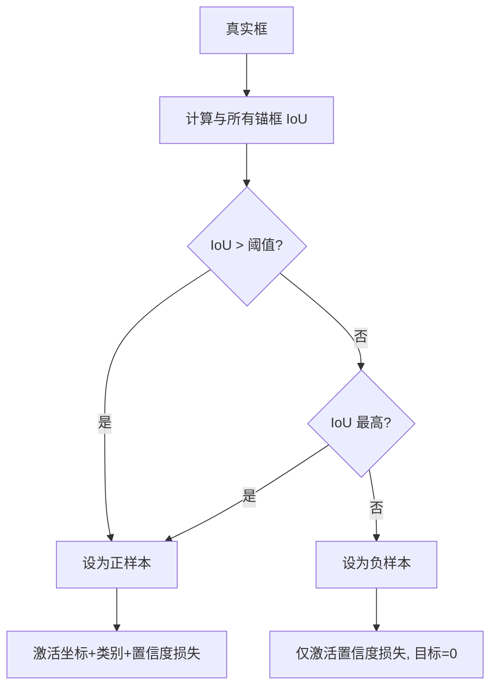

# YOLO原理分析：（YOLOv3）（锚框匹配与正样本分配策略）（解决正负样本失衡与召回率低问题）

## 前言

YOLOv3 改进了**锚框匹配与正样本分配策略**，不再要求真实框必须与某个锚框形状最匹配才算正样本，而是只要锚框与真实框的 **IoU** 超过一定阈值，或者锚框是与真实框 IoU 最高的几个之一，就将其设为正样本。这一策略大幅增加了正样本数量，缓解了正负样本不平衡问题，显著提升了检测召回率。这是单阶段检测中正样本分配策略的重要演进，直接影响后续版本的样本分配设计。

## 背景：前一代的痛点

YOLOv2 的正样本分配规则较为严格：

1. **正样本稀少**：每个真实框只分配给一个 IoU 最高的锚框作为正样本，大量锚框为负样本。
2. **正负样本失衡**：负样本数量远多于正样本，训练时梯度被负样本主导，正样本学习不充分。
3. **召回率受限**：正样本太少，导致很多真实目标没有被任何锚框匹配到，召回率偏低。

## 原理详述

### YOLOv2 的匹配规则

YOLOv2 中，正样本分配规则是：
- 对每个真实框，找到 IoU 最高的那个锚框
- 只有这个锚框被设为正样本
- 其余所有锚框都是负样本（置信度目标为 0）

这种"一框一锚"的严格匹配，导致正样本数量极少。

### YOLOv3 的改进策略

YOLOv3 放宽了正样本定义：

**规则一：IoU 阈值匹配**

如果某个锚框与真实框的 IoU 超过设定阈值（如 0.5），则该锚框也被设为正样本。

**规则二：最佳匹配保底**

即使 IoU 都不超过阈值，IoU 最高的那个锚框仍然被设为正样本，确保每个真实框至少有一个正样本锚框。

### 多正样本机制

与 YOLOv2 每个真实框仅对应 1 个正样本锚框不同，YOLOv3 中一个真实框可以对应多个正样本锚框：

```text
示例: 一个真实框与 3 个锚框的 IoU:
  锚框A: IoU = 0.7  → 正样本 ✓
  锚框B: IoU = 0.6  → 正样本 ✓
  锚框C: IoU = 0.3  → 负样本

结果: 一个真实框对应 2 个正样本锚框
```

### 置信度目标调整

对于正样本锚框：
- 置信度目标 = 1（或真实 IoU 值）
- 坐标损失被激活
- 类别损失被激活

对于负样本锚框：
- 置信度目标 = 0
- 坐标与类别损失不激活

### 为什么这样改进有效

1. **增加正样本数量**：更多锚框参与正样本训练，梯度信号更丰富。
2. **提升召回率**：更多锚框被激活为正样本，意味着更多预测框有机会检测到目标。
3. **平衡正负样本**：正样本增加后，负样本的主导地位减弱，训练更平衡。

### 与多尺度预测的配合

YOLOv3 的三尺度预测与锚框分配配合：
- 9 个锚框分配到 3 个尺度
- 每个真实框在对应尺度上寻找最佳匹配锚框
- 匹配规则放宽后，每个尺度都有更多正样本

## 结构示意

```text
YOLOv2 匹配:
  真实框
    │
    ▼
  计算与所有锚框 IoU
    │
    ▼
  ┌─────────────────┐
  │ 只取 IoU 最高的 1 个 │
  │ → 唯一正样本        │
  │ 其余全部为负样本     │
  └─────────────────┘
  结果: 正样本极少

YOLOv3 匹配:
  真实框
    │
    ▼
  计算与所有锚框 IoU
    │
    ▼
  ┌──────────────────────────┐
  │ IoU > 阈值的锚框 → 正样本  │
  │ IoU 最高的锚框  → 保底正样本│
  │ 其余             → 负样本  │
  └──────────────────────────┘
  结果: 正样本数量显著增加
```



## 解决了什么问题

YOLOv3 的锚框匹配与正样本分配策略针对前一代样本分配的缺陷做出了以下改进：

1. **正负样本失衡**：放宽正样本定义后，正样本数量大幅增加，缓解了负样本主导训练的问题。
2. **召回率低**：更多锚框被激活为正样本，检测网络能覆盖更多目标，召回率显著提升。
3. **训练不充分**：正样本梯度信号更丰富，模型对目标特征的学习更充分。

## 效果与影响

这一策略调整是 YOLOv3 检测精度提升的重要贡献因素之一。更多的正样本意味着更充分的训练和更高的召回率。后续 YOLOv4 在此基础上引入了 **CIoU** 匹配等更精细的分配策略，YOLOv5 进一步发展为自适应锚框分配。正样本分配策略的持续改进是单阶段检测精度提升的关键脉络之一，YOLOv3 的放宽匹配策略是这一脉络上的重要一步。

---

- 本博客采用生成式AI工具辅助完成撰写
- 本博客所有数据、架构、性能指标均为AI推演生成，不代表生产实践实测结果
- 本博客技术细节仅作为技术探索使用，不构成任何生产实践的指导建议
- 本博客作者不对直接或间接参考本博客开展生产实践所产生的后果负责

