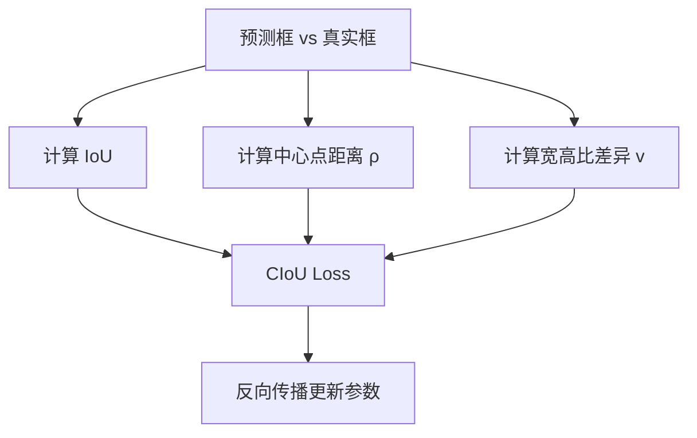

# YOLO原理分析：（YOLOv4）（CIoU损失函数）（解决边界框回归收敛慢与定位不准问题）

## 前言

YOLOv4 采用 **CIoU**（Complete Intersection over Union，完全交并比）作为边界框回归损失。此前 YOLO 系列使用均方误差回归边界框坐标，存在收敛慢、定位不精确等问题。CIoU 综合考虑了重叠面积、中心点距离和宽高比三个因素，使边界框回归更加稳定和准确。这一损失函数设计是 YOLOv4 检测精度提升的重要贡献，也是目标检测回归损失领域的重要演进。

## 背景：前一代的痛点

YOLOv1 至 YOLOv3 的边界框回归使用均方误差（MSE）：

$$
L_{\text{coord}} = \sum (x_i - \hat{x}_i)^2 + (y_i - \hat{y}_i)^2 + (w_i - \hat{w}_i)^2 + (h_i - \hat{h}_i)^2
$$

存在以下问题：

1. **各维度独立优化**：坐标的四个分量独立计算损失，没有考虑它们之间的关联。
2. **与评价指标脱节**：MSE 优化目标与最终评价指标 **IoU** 不一致，训练最优不等于检测最优。
3. **收敛慢**：小目标的坐标误差被均方误差放大，大目标则被稀释，训练不稳定。

## 原理详述

### IoU 损失的局限

早期改进思路是直接使用 IoU 作为损失：

$$
L_{\text{IoU}} = 1 - \text{IoU}(A, B)
$$

但 IoU 损失存在问题：如果两个框不重叠，IoU = 0，损失为 1，无法提供梯度，无法优化。

### DIoU 损失

DIoU（Distance IoU）在 IoU 基础上加入了中心点距离因素：

$$
L_{\text{DIoU}} = 1 - \text{IoU} + \frac{\rho^2(b, b^{gt})}{c^2}
$$

其中：
- $\rho(b, b^{gt})$：预测框中心点与真实框中心点的欧氏距离
- $c$：同时包含预测框和真实框的最小外接矩形的对角线长度

DIoU 的优势：
- 即使两个框不重叠，中心点距离仍然提供梯度信号
- 收敛速度比 IoU 损失快

### CIoU 损失

CIoU 在 DIoU 基础上进一步加入了宽高比一致性：

$$
L_{\text{CIoU}} = 1 - \text{IoU} + \frac{\rho^2(b, b^{gt})}{c^2} + \alpha v
$$

其中：
- $v$：衡量宽高比的一致性
  $$
  v = \frac{4}{\pi^2} \left(\arctan\frac{w^{gt}}{h^{gt}} - \arctan\frac{w}{h}\right)^2
  $$
- $\alpha$：权衡参数
  $$
  \alpha = \frac{v}{(1 - \text{IoU}) + v}
  $$

### 三个因素的意义

CIoU 综合考虑了三个几何因素：

1. **重叠面积**（IoU 项）：两个框重叠越多越好
2. **中心点距离**（$\rho^2 / c^2$ 项）：中心点越近越好
3. **宽高比一致性**（$\alpha v$ 项）：预测框与真实框的宽高比越接近越好

### 为什么 CIoU 更好

- **收敛更快**：中心点距离直接引导框向真实框移动，比逐坐标回归更快收敛。
- **定位更准**：宽高比一致性约束使预测框形状更贴合真实框。
- **不重叠也能优化**：即使初始框与真实框不重叠，中心点距离和宽高比都提供有效梯度。

## 结构示意

```text
边界框损失演进:

MSE (YOLOv1-v3):
  逐坐标独立回归
  → 收敛慢, 与 IoU 脱节

IoU Loss:
  直接优化 IoU
  → 不重叠时梯度消失

DIoU Loss:
  IoU + 中心点距离
  → 不重叠也有梯度, 收敛快

CIoU Loss:
  DIoU + 宽高比一致性
  → 收敛快 + 定位准 + 形状贴合
```



## 解决了什么问题

CIoU 损失函数针对 MSE 回归的缺陷做出了以下改进：

1. **收敛慢**：中心点距离引导使框回归更快收敛，训练时间缩短。
2. **定位不准**：宽高比一致性约束使预测框形状更精确地贴合真实框。
3. **评价指标脱节**：直接优化 IoU 相关指标，训练目标与评价目标一致。

## 效果与影响

CIoU 损失是 YOLOv4 检测精度提升的重要组成部分。更好的边界框回归意味着更精确的定位，尤其在小目标和密集场景下改善明显。CIoU 及其变体（DIoU、GIoU 等）已成为现代检测器的标准回归损失选择。YOLOv5 也沿用了 CIoU 损失，并在此基础上做了进一步微调。

---

- 本博客采用生成式AI工具辅助完成撰写
- 本博客所有数据、架构、性能指标均为AI推演生成，不代表生产实践实测结果
- 本博客技术细节仅作为技术探索使用，不构成任何生产实践的指导建议
- 本博客作者不对直接或间接参考本博客开展生产实践所产生的后果负责

