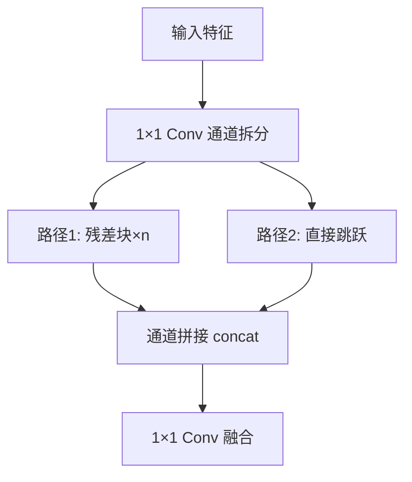

# YOLO原理分析：（YOLOv4）（CSPDarknet53主干网络）（解决特征提取与计算效率平衡问题）

## 前言

YOLOv4 采用 **CSPDarknet53** 作为主干网络，将 CSP（Cross Stage Partial，跨阶段局部连接）思想引入 Darknet-53。此前 YOLOv3 的 Darknet-53 虽然特征表达能力强，但计算量较大。CSPDarknet53 通过将特征图在通道维度拆分为两部分，一部分经过残差块处理，另一部分直接跨阶段拼接，在减少计算量的同时保留了丰富的梯度组合。这一设计实现了精度与速度的更好平衡，成为 YOLOv4 高性能的核心基础。

## 背景：前一代的痛点

Darknet-53 作为 YOLOv3 的主干网络，存在以下问题：

1. **计算量大**：53 层网络，尤其是深层的 1024 通道特征图，卷积计算开销可观。
2. **重复特征学习**：大量残差块堆叠后，不同层学习到的特征存在冗余，计算效率不高。
3. **内存访问开销**：深层网络中间特征图占用大量显存，内存访问成为瓶颈。

如何在不损失精度的前提下降低计算量，是 YOLOv4 主干网络设计的核心挑战。

## 原理详述

### CSP 核心思想

CSP（Cross Stage Partial）的核心思想是：将输入特征图在通道维度拆分为两部分：

- 一部分经过残差块（或卷积块）序列处理
- 另一部分直接"跳跃"到阶段末尾，与处理后的特征拼接

这样做的好处：
1. **减少计算量**：只有一半通道经过残差块计算
2. **保留梯度流**：直接跳跃的部分提供了另一条梯度回传路径
3. **特征多样性**：拼接后的特征包含两种不同处理路径的信息

### CSPDarknet53 的结构

CSPDarknet53 在 Darknet-53 的基础上，将每个阶段的残差块组替换为 CSP 模块：

```text
CSP 模块结构:
  输入特征图
      │
      ├── 1×1 Conv 拆分通道 ──→ 分支A (经过 n 个残差块)
      │
      └──────────────────────→ 分支B (直接跳跃)
      
  阶段末尾:
    分支A输出 + 分支B输出 → 通道拼接 → 1×1 Conv 融合
```

### 具体拆分方式

以某个阶段为例：

1. 输入特征图经过 $1 \times 1$ 卷积，将通道数压缩为原来的一半
2. 拆分后的两路：
   - **路径 1**：经过 $n$ 个残差块（YOLOv4 中各阶段的残差块数量与 Darknet-53 对应）
   - **路径 2**：直接连接到阶段末端
3. 两路在通道维度拼接
4. 拼接后经过 $1 \times 1$ 卷积融合特征

### 为什么有效

**减少计算量**：只有一半通道数经过 $n$ 个残差块，卷积计算量大幅减少。

**丰富梯度组合**：CSP 的设计使梯度在回传时可以走两条路径（经过残差块的路径和直接跳跃的路径），梯度组合更加丰富，有助于避免梯度消失。

**降低内存开销**：中间特征图的通道数减半，显存占用降低。

### CSPDarknet53 的整体架构

```text
输入 416×416×3
    │
  Conv 3×3, 32 filters
    │
  CSP阶段1 (64ch, 1个残差块)
    │
  CSP阶段2 (128ch, 2个残差块)
    │
  CSP阶段3 (256ch, 8个残差块)  ← 输出给 FPN
    │
  CSP阶段4 (512ch, 8个残差块)  ← 输出给 FPN
    │
  CSP阶段5 (1024ch, 4个残差块) ← 输出给 FPN
```

总共 53 个卷积层，因此仍称为 Darknet53 的变体。

## 结构示意

```text
Darknet-53 (YOLOv3):
  输入
    │
  [残差块×1] → [残差块×2] → [残差块×8] → [残差块×8] → [残差块×4]
  全部通道经过所有残差块

CSPDarknet53 (YOLOv4):
  输入
    │
  ┌─────────────────────────────────┐
  │ CSP阶段:                        │
  │   输入 → 1×1 Conv (通道减半)     │
  │     ├→ 残差块×n ──→ ┐           │
  │     └──────────────┼→ concat → 1×1 Conv
  │                     ┘           │
  └─────────────────────────────────┘
  只有一半通道经过残差块
```



## 解决了什么问题

CSPDarknet53 针对 Darknet-53 的痛点做出了以下改进：

1. **计算量大**：通道拆分后仅一半特征经过残差块，计算量显著降低。
2. **特征冗余**：CSP 结构使梯度组合更丰富，减少了无效的重复特征学习。
3. **内存开销**：中间特征通道数减半，显存占用下降。

## 效果与影响

CSPDarknet53 在保持与 Darknet-53 相当甚至更优特征表达能力的同时，显著降低了计算量和内存占用。这使得 YOLOv4 在 通用并行计算设备 上的推理速度比 YOLOv3 更快，同时精度更高。CSP 思想后来被 YOLOv5 继承并进一步优化（拆分为 CSP1_X 和 CSP2_X 两种变体），成为现代高效主干网络的标准设计范式之一。


---

- 本博客采用生成式AI工具辅助完成撰写
- 本博客所有数据、架构、性能指标均为AI推演生成，不代表生产实践实测结果
- 本博客技术细节仅作为技术探索使用，不构成任何生产实践的指导建议
- 本博客作者不对直接或间接参考本博客开展生产实践所产生的后果负责

