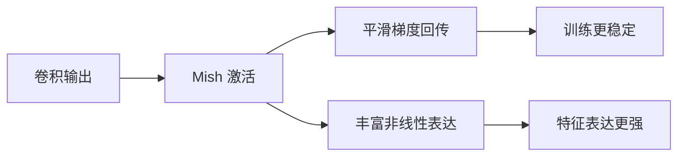

# YOLO原理分析：（YOLOv4）（Mish激活函数）（解决深层网络梯度传播与非线性表达问题）

## 前言

YOLOv4 在主干网络中采用 **Mish** 激活函数，替代此前的 LeakyReLU。Mish 是一种自正则化的非单调激活函数，具有平滑、连续可导的特性，能够在深层网络中提供更好的梯度流动和更强的非线性表达能力。在 YOLOv4 中，主干网络使用 Mish，检测头使用 LeakyReLU，这种混合配置兼顾了特征提取能力与推理效率。Mish 的引入是 YOLOv4 精度提升的重要贡献之一，也是"Bag-of-Specials"的代表性组件。

## 背景：前一代的痛点

YOLOv1 至 YOLOv3 均使用 LeakyReLU 作为激活函数：

$$
\text{LeakyReLU}(x) = \begin{cases}
x & x > 0 \\
\alpha x & x \le 0
\end{cases}
$$

LeakyReLU 虽然简单高效，但存在局限：

1. **非平滑**：在 $x=0$ 处函数折角，不是连续可导的，可能导致训练震荡。
2. **线性负半轴**：负半轴是线性的，非线性表达能力受限。
3. **自正则化不足**：缺乏天然的正则化效果，需要配合其他手段防止过拟合。

## 原理详述

### Mish 函数定义

Mish 激活函数的数学表达式：

$$
\text{Mish}(x) = x \cdot \tanh(\text{softplus}(x))
$$

其中：
$$
\text{softplus}(x) = \ln(1 + e^x)
$$

展开后：
$$
\text{Mish}(x) = x \cdot \tanh(\ln(1 + e^x))
$$

### Mish 的特性

**1. 平滑性**

Mish 在整个实数域上是平滑、连续可导的，没有折角。这使得梯度计算更加稳定，减少训练震荡。

**2. 非单调性**

与 ReLU/LeakyReLU 的单侧线性不同，Mish 在负值区域有轻微的非单调波动。这种非单调性带来了更丰富的非线性表达。

**3. 无上界、有下界**

- 无上界：避免正向饱和导致的梯度消失
- 有下界（约 -0.1 附近）：提供轻微的正则化效果

**4. 自正则化**

Mish 函数的平滑特性使其具有一定的自正则化效果，有助于抑制过拟合。

### 与 LeakyReLU 的对比

```text
LeakyReLU:
  正半轴: 线性 (y=x)
  负半轴: 线性 (y=αx)
  折角: x=0 处不可导

Mish:
  整体: 平滑曲线, 处处可导
  正半轴: 近似线性但有细微弯曲
  负半轴: 非单调, 有小范围波动
  无折角: 函数连续光滑
```

### YOLOv4 中的使用位置

YOLOv4 采用混合激活策略：
- **主干网络 CSPDarknet53**：使用 Mish 激活（特征提取阶段需要更强表达能力）
- **颈部 PANet 与检测头**：使用 LeakyReLU（推理效率优先）

这种分工是因为主干网络计算量相对较小但对特征表达至关重要，而检测头部分计算量大、对精度影响相对间接。

### 计算开销

Mish 涉及 $\tanh$ 和 $\ln$ 运算，计算量略高于 LeakyReLU。但在主干网络中使用时，由于特征图通道数相对可控，额外开销在可接受范围内。

## 结构示意

```text
LeakyReLU 曲线 (示意):
  y
  │    ╱
  │   ╱
  │  ╱
  ──┼────────── x
  │╲
  │ ╲ (斜率很小)
  x=0 处折角

Mish 曲线 (示意):
  y
  │      ╭───
  │    ╭─╯
  │  ╭─╯
  ──┼╯────────── x
  │  ╰╮
  │   ╰╮__
  整体平滑, 无折角, 负半轴轻微波动
```



## 解决了什么问题

Mish 激活函数针对 LeakyReLU 的局限做出了以下改进：

1. **梯度传播**：平滑连续可导的特性使梯度流动更健康，减少训练震荡。
2. **非线性表达**：非单调的平滑曲线提供了比 LeakyReLU 更强的非线性变换能力。
3. **正则化效果**：Mish 的自正则化特性有助于抑制过拟合。

## 效果与影响

在 YOLOv4 中，主干网络使用 Mish 后，分类精度和检测精度相比使用 LeakyReLU 均有提升。Mish 的引入是 YOLOv4 "Bag-of-Specials" 策略的重要组成部分——即在计算量允许的模块中使用更先进但稍复杂的组件。后续 YOLOv5 改用更轻量的 SiLU/Swish 激活函数，Mish 因其计算开销较大而未被后续版本延续，但其在特征提取阶段的优势得到了验证。


---

- 本博客采用生成式AI工具辅助完成撰写
- 本博客所有数据、架构、性能指标均为AI推演生成，不代表生产实践实测结果
- 本博客技术细节仅作为技术探索使用，不构成任何生产实践的指导建议
- 本博客作者不对直接或间接参考本博客开展生产实践所产生的后果负责

