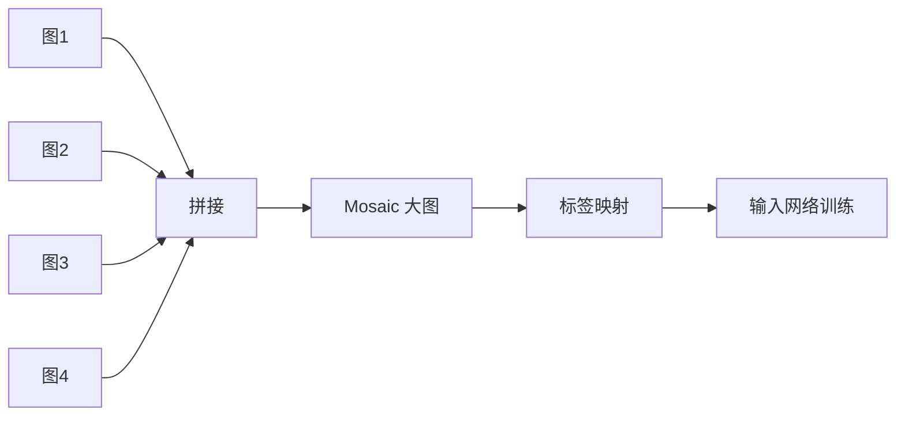

# YOLO原理分析：（YOLOv4）（Mosaic数据增强）（解决小目标样本不足与过拟合问题）

## 前言

YOLOv4 引入 **Mosaic** 数据增强方法，将四张训练图像随机拼接成一张图像进行训练。此前常用的数据增强手段（随机裁剪、翻转、颜色抖动等）都是单图变换，样本多样性有限。Mosaic 通过多图拼接，使一张训练图像中同时出现四个不同场景的目标，极大丰富了训练样本的上下文多样性，同时变相增加了批量大小的效果。Mosaic 是 YOLOv4 "Bag-of-Freebies" 中最具代表性的技术之一，也是后续 YOLOv5 等版本的标准数据增强策略。

## 背景：前一代的痛点

传统数据增强方法存在以下局限：

1. **单图变换**：每张图独立增强，样本之间没有交互，上下文多样性有限。
2. **小目标样本少**：小目标在图像中占比极小，网络见到的小目标样本不够多。
3. **批量大小受限**：加速设备显存有限，批量大小不能太大，统计估计不够稳定。

## 原理详述

### Mosaic 操作流程

Mosaic 的核心步骤：

1. **选取四张图像**：从训练集中随机选取四张图像
2. **随机裁剪/缩放**：每张图像随机缩放到不同尺寸
3. **随机拼接**：将四张图拼接成一张大图，拼接位置随机
4. **统一标签**：将四张图的标注框映射到拼接后的大图上

### 拼接方式示意

```text
原始四张图:
  ┌──────┐  ┌──────┐
  │ 图A  │  │ 图B  │
  └──────┘  └──────┘
  ┌──────┐  ┌──────┐
  │ 图C  │  │ 图D  │
  └──────┘  └──────┘

Mosaic 拼接后 (随机位置):
  ┌──────────┬────────┐
  │  图A     │  图B   │
  │  (缩放)  │        │
  │          ├────┬───┤
  │          │图C  │   │
  ├──────────┤(缩)│图D│
  │ 图C 边缘  │    │   │
  │          ┴────┴───┤
  └───────────────────┘
```

### 为什么有效

**1. 丰富上下文多样性**

一张训练图中包含四个不同场景的目标，网络在单次前向中就能见到多种上下文，学习到更鲁棒的特征。

**2. 增加小目标样本**

拼接后，小目标出现在更大尺寸的图像中，相当于变相增加了小目标的数量和可见性。

**3. 正则化效果**

多图拼接使网络不容易过拟合到特定图像的背景或光照条件，具有天然的正则化效果。

**4. 变相增大批量**

一张 Mosaic 图包含相当于四张图的内容，效果类似于批量大小扩大了 4 倍，统计更稳定。

### 标签处理

四张图的标注框需要映射到拼接后的坐标：
- 每张图的标注框加上该图在大图中的偏移量
- 超出拼接边界的框被裁剪到有效范围内
- 过小的框（如小于某个像素阈值）被丢弃

### 与其他增强的配合

Mosaic 通常与其他增强手段组合使用：
- 随机翻转
- 颜色空间扰动
- 随机缩放

## 结构示意

```text
训练集中随机取 4 张图
    │
    ├─→ 图A (随机缩放)
    ├─→ 图B (随机缩放)
    ├─→ 图C (随机缩放)
    └─→ 图D (随机缩放)
    │
    ▼
随机拼接成 1 张大图
    │
    ▼
标注框映射到新坐标
    │
    ▼
输入网络训练
```



## 解决了什么问题

Mosaic 数据增强针对传统单图增强的局限做出了以下改进：

1. **样本多样性不足**：四图拼接使单张训练图包含四种场景，上下文多样性大幅提升。
2. **小目标样本少**：拼接后小目标的相对可见度增加，网络见过更多小目标。
3. **过拟合风险**：多图混合引入了更多背景与光照变化，正则化效果显著。

## 效果与影响

Mosaic 是 YOLOv4 在不增加推理成本的前提下提升精度的关键技术之一——属于 "Bag-of-Freebies"（免费赠品），即只在训练时使用，不影响推理速度。这一方法被 YOLOv5 完整继承并作为默认数据增强策略，后续版本也普遍采用。Mosaic 的设计思路——多图拼接、丰富上下文——已成为现代检测训练的标准做法。

---

- 本博客采用生成式AI工具辅助完成撰写
- 本博客所有数据、架构、性能指标均为AI推演生成，不代表生产实践实测结果
- 本博客技术细节仅作为技术探索使用，不构成任何生产实践的指导建议
- 本博客作者不对直接或间接参考本博客开展生产实践所产生的后果负责

