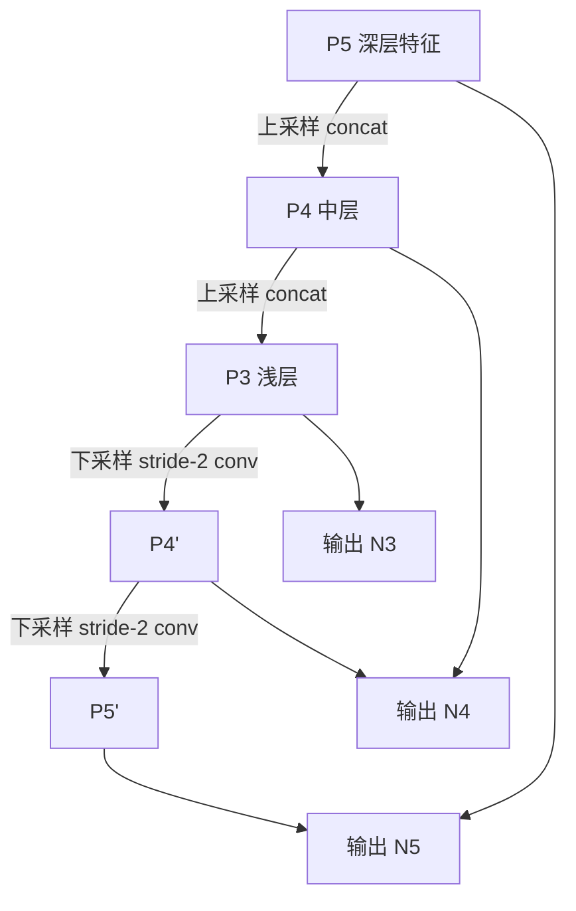

# YOLO原理分析：（YOLOv4）（PANet路径聚合颈部特征融合）（解决深浅层特征信息流通不畅问题）

## 前言

YOLOv4 在颈部网络采用 **PANet**（Path Aggregation Network，路径聚合网络）结构进行特征融合。此前 YOLOv3 的特征金字塔只有自上而下的上采样路径，深层特征向浅层传递，但浅层的定位信息无法有效回传到深层。PANet 在 FPN 的自上而下路径基础上，增加了一条自下而上的路径，形成双向特征融合回路，使深浅层特征信息充分流通。这一设计显著提升了多尺度特征融合的质量，是 YOLOv4 精度大幅提升的关键模块之一。

## 背景：前一代的痛点

YOLOv3 的 FPN 式特征融合只有一条自上而下的路径：

```text
深层特征 (语义强)
    ↓ 上采样 + concat
中层特征
    ↓ 上采样 + concat
浅层特征 (定位强)
```

存在的问题：

1. **单向信息流**：只有深层→浅层的传递，浅层→深层的信息通路缺失。
2. **定位信息丢失**：浅层特征的精确定位信息无法有效传递到深层，影响大目标定位精度。
3. **特征融合不充分**：深浅层特征只融合一次，没有充分交互。

## 原理详述

### PANet 的双向路径

PANet 在 FPN 基础上增加了自下而上的第二条路径：

**自上而下路径（FPN 原有）**：
- 深层特征上采样 → 与中层特征拼接 → 上采样 → 与浅层特征拼接

**自下而上路径（PANet 新增）**：
- 浅层特征下采样 → 与中层特征拼接 → 下采样 → 与深层特征拼接

两条路径形成一个双向回路。

### 特征融合细节

YOLOv4 中 PANet 的具体结构：

```text
主干输出三个尺度:
  P3 (52×52, 浅层)
  P4 (26×26, 中层)
  P5 (13×13, 深层)

自上而下路径:
  P5 → 上采样 → concat P4 → 处理 → 上采样 → concat P3

自下而上路径:
  P3 → 下采样 → concat P4' → 处理 → 下采样 → concat P5'

最终输出三个融合后的特征图:
  N3 (52×52), N4 (26×26), N5 (13×13)
```

### 下采样方式

自下而上路径中的下采样使用步长为 2 的卷积：
- 步长 = 2 的卷积使特征图尺寸减半
- 同时调整通道数

### 拼接方式

特征融合采用通道拼接（concat）而非逐元素相加：
- 拼接后特征通道数翻倍
- 再通过 $1 \times 1$ 卷积调整通道数并融合信息

### 为什么双向融合更好

1. **语义信息传递**：自上而下路径让深层语义信息到达浅层，帮助小目标分类。
2. **定位信息回传**：自下而上路径让浅层精确定位信息到达深层，帮助大目标定位。
3. **多轮交互**：双向路径使深浅层特征多次交互，融合更充分。

### YOLOv4 中的完整颈部结构

```text
CSPDarknet53 → SPP → PANet → 检测头

PANet 部分:
  P5 (深层) ──→ 上采样 ──→ concat P4 ──→ 上采样 ──→ concat P3
    ↑                                              │
    │                                              ↓
  下采样 ←── concat P4' ←── 下采样 ←──────────── P3'
```

## 结构示意

```text
FPN (YOLOv3): 单向
  P5 ──up──→ P4 ──up──→ P3
  (语义→定位方向)

PANet (YOLOv4): 双向
  P5 ←──down── P4 ←──down── P3
  ↑                              │
  └────────up──→ P4' ──up──→ P3'

  两条路径形成闭环
  信息在深浅层之间双向流动
```



## 解决了什么问题

PANet 路径聚合针对 FPN 单向融合的缺陷做出了以下改进：

1. **信息流通不畅**：增加自下而上路径后，浅层定位信息可以传递到深层，双向信息流通。
2. **特征融合不充分**：多轮双向交互使深浅层特征充分融合，每个尺度的输出都包含丰富的上下文信息。
3. **定位精度**：浅层定位信息回传后，深层输出的大目标定位更加精确。

## 效果与影响

PANet 是 YOLOv4 相比 YOLOv3 精度大幅提升的核心模块之一。双向路径聚合使特征融合质量显著提升，尤其在中小目标检测精度上改善明显。这一设计被 YOLOv5 完整继承，并成为现代检测器颈部网络的标准范式。从 FPN 的单向到 PANet 的双向，特征融合的深度和方向不断丰富，反映了检测领域对多尺度特征利用的持续探索。

---

- 本博客采用生成式AI工具辅助完成撰写
- 本博客所有数据、架构、性能指标均为AI推演生成，不代表生产实践实测结果
- 本博客技术细节仅作为技术探索使用，不构成任何生产实践的指导建议
- 本博客作者不对直接或间接参考本博客开展生产实践所产生的后果负责

