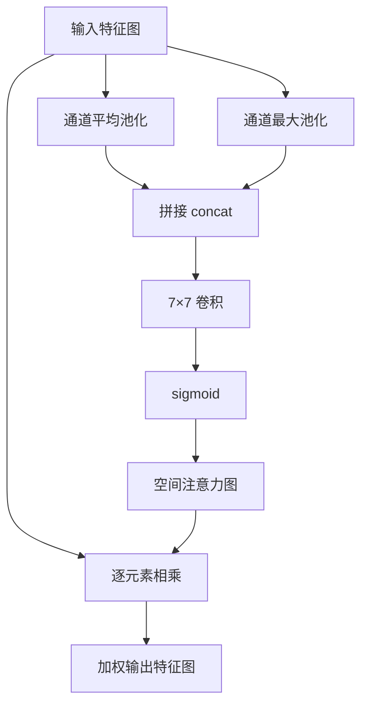

# YOLO原理分析：（YOLOv4）（SAM空间注意力机制）（解决特征图有效通道权重分配问题）

## 前言

YOLOv4 在颈部网络中引入 **SAM**（Spatial Attention Module，空间注意力模块），通过空间注意力机制对特征图的不同空间位置施加权重。此前特征图所有位置一视同仁，没有区分"哪些区域更重要"。SAM 模块学习生成空间注意力图，让网络自动关注目标所在的关键区域，抑制无关背景区域的特征响应。这一设计是 YOLOv4 "Bag-of-Specials" 的组件之一，以较小的计算代价提升了特征图的有效信噪比。

## 背景：前一代的痛点

传统卷积神经网络中，特征图的所有空间位置被同等对待：

1. **注意力缺失**：网络不知道图像中哪些区域是目标、哪些是背景，所有位置都参与后续计算。
2. **背景干扰**：背景区域的特征响应可能被错误地用于目标分类与定位，引入噪声。
3. **特征利用率低**：大量计算花在无关背景区域上，特征表达效率不高。

## 原理详述

### SAM 的基本结构

SAM（Spatial Attention Module）的核心思想是：在空间维度上生成注意力权重图，对特征图的不同位置进行加权。

```text
输入特征图 F
    │
    ├─→ 全局平均池化 (通道维度) ──→ 空间描述1
    ├─→ 全局最大池化 (通道维度) ──→ 空间描述2
    │
    ▼
两个空间描述拼接 → 7×7 卷积 → sigmoid → 空间注意力图 M
    │
    ▼
输出 = F × M (逐元素相乘)
```

### 具体操作步骤

**步骤 1：通道维度压缩**

对输入特征图 $F \in \mathbb{R}^{C \times H \times W}$，在通道维度上分别做：
- 全局平均池化：得到 $F_{\text{avg}} \in \mathbb{R}^{1 \times H \times W}$
- 全局最大池化：得到 $F_{\text{max}} \in \mathbb{R}^{1 \times H \times W}$

这两个操作将通道信息压缩为空间描述图。

**步骤 2：生成空间注意力图**

将两个空间描述在通道维度拼接：
$$
F_{\text{concat}} = \text{Concat}(F_{\text{avg}}, F_{\text{max}})
$$

然后经过 $7 \times 7$ 卷积 + sigmoid：
$$
M_s(F) = \sigma\left(f^{7 \times 7}([F_{\text{avg}}; F_{\text{max}}])\right)
$$

其中 $\sigma$ 是 sigmoid 函数，$f^{7 \times 7}$ 是 $7 \times 7$ 卷积。

**步骤 3：加权输出**

$$
F' = M_s(F) \otimes F
$$

其中 $\otimes$ 是逐元素相乘。注意力图 $M_s$ 中值越大的位置，原始特征被保留得越多；值越小的位置，特征被抑制。

### 在 YOLOv4 中的位置

YOLOv4 将 SAM 模块插入在 PANet 颈部的特征融合之后、检测头之前。具体来说，在每个尺度的融合特征图后接一个 SAM 模块，对空间位置加权后再送入检测头。

### 为什么用 7×7 卷积

空间注意力需要较大的感受野来捕捉上下文关系。$7 \times 7$ 卷积在保持较轻计算量的同时，提供了足够大的感受野，使注意力图能够根据周围上下文判断哪些区域重要。

## 结构示意

```text
输入特征图 (C×H×W)
    │
    ├─→ 通道平均池化 → (1×H×W) ──┐
    │                              ├─ concat → 7×7 Conv → sigmoid → 注意力图 (1×H×W)
    └─→ 通道最大池化 → (1×H×W) ──┘
                                              │
                                              ▼
输出 = 原特征图 × 注意力图 (逐元素相乘)
```



## 解决了什么问题

SAM 空间注意力针对特征图空间位置一视同仁的缺陷做出了以下改进：

1. **注意力机制**：网络自动学习关注目标区域，抑制无关背景，提升特征信噪比。
2. **减少背景干扰**：背景区域的特征响应被加权抑制，减少误检。
3. **提升特征效率**：计算资源集中在重要区域，特征表达更高效。

## 效果与影响

SAM 模块以较小的计算代价（仅增加一层 $7 \times 7$ 卷积）提升了特征图的有效表达能力。在 YOLOv4 中，SAM 是颈部网络的辅助增强组件，对精度有小幅但稳定的提升。后续 YOLOv5 没有沿用 SAM（改用更高效的 CSP 结构本身的特征选择机制），但空间注意力的思想——让网络自动关注重要区域——已成为现代注意力机制的重要组成部分，被后续大量工作采用。


---

- 本博客采用生成式AI工具辅助完成撰写
- 本博客所有数据、架构、性能指标均为AI推演生成，不代表生产实践实测结果
- 本博客技术细节仅作为技术探索使用，不构成任何生产实践的指导建议
- 本博客作者不对直接或间接参考本博客开展生产实践所产生的后果负责

