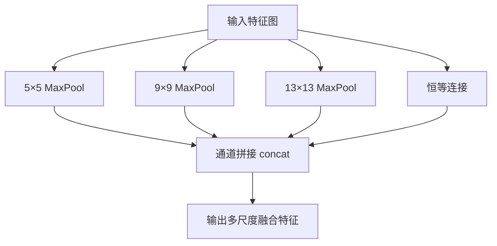

# YOLO原理分析：（YOLOv4）（SPP空间金字塔池化）（解决感受野与全局特征融合不足问题）

## 前言

YOLOv4 在颈部网络中引入 **SPP**（Spatial Pyramid Pooling，空间金字塔池化）模块，通过多个不同尺度的最大池化核并行处理特征图，增大感受野并融合多尺度上下文信息。此前 YOLOv3 的特征金字塔主要依赖上采样与浅层特征拼接，缺乏对全局上下文信息的多尺度池化提取。SPP 模块使网络能够同时感知不同尺度的感受野，显著增强了对大目标和复杂场景的特征表达能力，是 YOLOv4 "Bag-of-Specials" 的关键组件之一。

## 背景：前一代的痛点

YOLOv3 的特征融合路径主要是自上而下的上采样+拼接，存在以下局限：

1. **感受野受限**：卷积层的感受野有限，即使深层特征图也难以捕获全局上下文。
2. **多尺度池化缺失**：没有显式的多尺度池化操作，不同尺度的上下文信息没有被充分提取。
3. **大目标特征不足**：对占据画面较大比例的目标，需要更大的感受野来理解其完整轮廓。

## 原理详述

### SPP 模块结构

SPP 模块将输入特征图分别通过多个不同大小的最大池化核，然后将结果拼接：

```text
输入特征图
    ├──→ 5×5 MaxPool ──→ 路径1
    ├──→ 9×9 MaxPool ──→ 路径2
    ├──→ 13×13 MaxPool ─→ 路径3
    └──→ 直接跳跃 ──────→ 路径4 (无池化)
    
    四条路径 → 通道拼接 → 输出
```

YOLOv4 中 SPP 使用的池化核大小通常为 $5 \times 5$、$9 \times 9$、$13 \times 13$，步长均为 1，并用相应填充保持特征图尺寸不变。

### 为什么步长为 1、尺寸不变

与原始 SPP 论文中改变特征图尺寸不同，YOLOv4 中的 SPP 保持特征图尺寸不变：
- 池化步长 = 1
- 填充（padding）使输出尺寸 = 输入尺寸
- 这样 SPP 可以无缝插入到网络中，不改变后续层的尺寸

### 多尺度感受野的意义

不同大小的池化核提供不同的感受野：

- $5 \times 5$ 池化：捕获局部邻域信息
- $9 \times 9$ 池化：捕获中等范围上下文
- $13 \times 13$ 池化：捕获大范围全局信息
- 无池化路径：保留原始特征

拼接后，每个位置的特征向量同时包含了多个尺度的上下文信息。

### 在 YOLOv4 中的位置

SPP 模块插入在主干网络之后、PANet 颈部之前：

```text
CSPDarknet53 主干
    │
    ▼
SPP 模块 (多尺度池化)
    │
    ▼
PANet 颈部 (路径聚合)
    │
    ▼
检测头
```

### 计算量分析

SPP 模块的计算量主要来自最大池化操作，池化的计算开销远小于卷积。因此 SPP 以极低的计算代价换取了多尺度感受野的增强，性价比极高。

## 结构示意

```text
SPP 模块:

输入特征图 (13×13×C)
    │
    ├─→ MaxPool 5×5, pad=2 ──→ 13×13×C ──┐
    │                                      │
    ├─→ MaxPool 9×9, pad=4 ──→ 13×13×C ──┤
    │                                      ├─ concat → 13×13×4C
    ├─→ MaxPool 13×13, pad=6 → 13×13×C ──┤
    │                                      │
    └─→ 恒等连接 (无池化)     → 13×13×C ──┘

输出: 13×13×4C
```



## 解决了什么问题

SPP 模块针对前一代特征融合的局限做出了以下改进：

1. **感受野不足**：多尺度池化并行操作提供了从局部到全局的多种感受野。
2. **全局上下文缺失**：$13 \times 13$ 大核池化使网络能够捕获全局上下文信息。
3. **大目标检测**：增强的感受野提升了对大目标的整体特征理解能力。

## 效果与影响

SPP 模块以极低的计算代价显著增强了特征表达能力，是 YOLOv4 精度提升的重要贡献之一。由于其高效性，SPP 被保留在后续 YOLOv5 中，并成为颈部网络的标准组件之一。SPP 的多尺度池化思想与 FPN 的多尺度特征融合形成互补——FPN 处理不同尺度特征图之间的纵向融合，SPP 处理同一特征图内的横向多尺度上下文提取。

---

- 本博客采用生成式AI工具辅助完成撰写
- 本博客所有数据、架构、性能指标均为AI推演生成，不代表生产实践实测结果
- 本博客技术细节仅作为技术探索使用，不构成任何生产实践的指导建议
- 本博客作者不对直接或间接参考本博客开展生产实践所产生的后果负责

