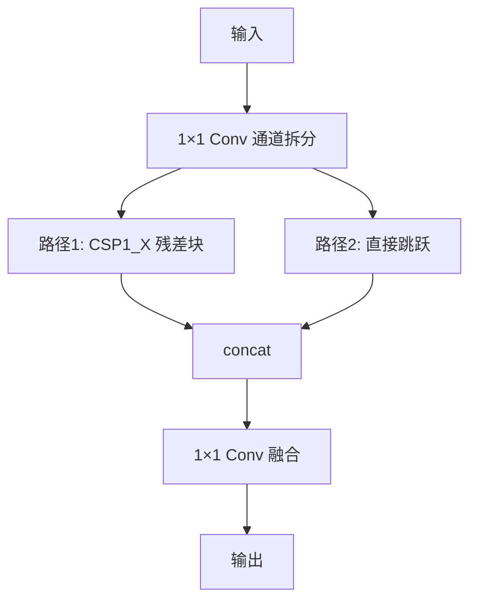

# YOLO原理分析：（YOLOv5）（CSP轻量化主干与颈部设计）（解决模型推理速度与精度平衡问题）

## 前言

YOLOv5 将 CSP 思想进一步轻量化，在主干和颈部中分别使用 **CSP1_X** 和 **CSP2_X** 两种变体结构。此前 YOLOv4 的 CSPDarknet53 已经引入了跨阶段局部连接，但结构相对固定。YOLOv5 根据主干和颈部的不同需求，设计了两种不同的 CSP 变体：主干使用较多残差块的 CSP1_X，颈部使用更轻量的 CSP2_X。这种精细化的模块化设计使 YOLOv5 在推理速度和精度之间取得了更优的平衡，体现了工程化优化的极致。

## 背景：前一代的痛点

YOLOv4 的 CSPDarknet53 虽然已经引入了 CSP 结构，但存在以下问题：

1. **结构单一**：主干和颈部使用类似的 CSP 结构，没有根据各自的需求做差异化设计。
2. **计算量冗余**：颈部网络也使用较多残差块，计算量偏大但收益有限。
3. **速度精度权衡不够精细**：整体模型在速度与精度的权衡上还有优化空间。

## 原理详述

### CSP1_X（主干使用）

CSP1_X 用于主干网络，包含 $X$ 个残差块：

```text
CSP1_X 结构:
  输入
    │
    ├→ 1×1 Conv (通道减半) ──→ 分支1: 残差块×X ──┐
    │                                            ├─ concat → 1×1 Conv
    └→ 恒等连接 ────────────────────────────────┘
```

特点：
- 分支 1 经过 $X$ 个残差块（bottleneck 结构）
- 残差块数量多（如 CSP1_3、CSP1_9）
- 适合特征提取阶段，需要较强的特征表达

### CSP2_X（颈部使用）

CSP2_X 用于 PANet 颈部，将残差块替换为更轻量的卷积块：

```text
CSP2_X 结构:
  输入
    │
    ├→ 1×1 Conv (通道减半) ──→ 分支1: (Conv×2)×X ──┐
    │                                                ├─ concat → 1×1 Conv
    └→ 恒等连接 ────────────────────────────────────┘
```

特点：
- 分支 1 经过 $X$ 个"$1 \times 1$ Conv + $3 \times 3$ Conv"模块
- 没有残差连接，结构更简单
- 计算量比 CSP1_X 小很多
- 适合颈部特征融合阶段，不需要那么强的表达能力

### 为什么分两种变体

**主干阶段**：特征提取是核心任务，需要深层、强表达能力的网络，因此用 CSP1_X（多残差块）。

**颈部阶段**：主要做特征融合，不需要极强的特征提取能力，用 CSP2_X（轻量卷积块）即可，节省计算量。

### 不同规模模型的设计

YOLOv5 提供了多种规模的模型（n/s/m/l/x），通过调整 CSP 模块的数量和宽度来平衡速度与精度：

| 模型规模 | 主干 CSP 残差块数 | 宽度倍数 |
|---------|-----------------|---------|
| n (nano) | 最少 | 最窄 |
| s (small) | 较少 | 较窄 |
| m (medium) | 中等 | 中等 |
| l (large) | 较多 | 较宽 |
| x (extra) | 最多 | 最宽 |

### 整体网络结构

```text
YOLOv5 整体:
  Input
    → Focus (或 Conv)
    → CSP1_3 (主干第1阶段)
    → CSP1_9 (主干第2阶段)
    → CSP1_9 (主干第3阶段)
    → CSP1_3 (主干第4阶段)
    → SPP
    → PANet 颈部:
        → 上采样 + CSP2_1
        → 下采样 + CSP2_1
        → 下采样 + CSP2_1
    → Detect 检测头
```

## 结构示意

```text
CSP1_X (主干):
  输入
    ├──→ [Conv → 残差块×X] ──┐
    │                         ├─ concat → Conv
    └──→ 恒等连接 ────────────┘

CSP2_X (颈部):
  输入
    ├──→ [Conv → (Conv×2)×X] ──┐
    │                           ├─ concat → Conv
    └──→ 恒等连接 ─────────────┘

区别:
  CSP1_X: 残差块 (bottleneck + shortcut)
  CSP2_X: 普通卷积块 (无 shortcut, 更轻量)
```



## 解决了什么问题

YOLOv5 的 CSP 轻量化设计针对前一代 CSP 结构单一的缺陷做出了以下改进：

1. **精细化分工**：主干用 CSP1_X（强表达），颈部用 CSP2_X（轻量融合），各取所需。
2. **计算量优化**：颈部计算量大幅降低，整体推理速度提升。
3. **模块化灵活**：不同规模模型通过调整 CSP 模块数量和宽度，灵活适配不同场景。

## 效果与影响

这种精细化的 CSP 变体设计使 YOLOv5 在保持高精度的同时，推理速度比 YOLOv4 快数倍。CSP1_X 和 CSP2_X 的分工设计体现了"在合适的位置用合适复杂度的模块"的工程优化思想。后续 YOLOv5 的持续迭代都在这一模块化框架下进行，CSP 变体设计已成为高效检测网络的标准范式。

---

- 本博客采用生成式AI工具辅助完成撰写
- 本博客所有数据、架构、性能指标均为AI推演生成，不代表生产实践实测结果
- 本博客技术细节仅作为技术探索使用，不构成任何生产实践的指导建议
- 本博客作者不对直接或间接参考本博客开展生产实践所产生的后果负责

