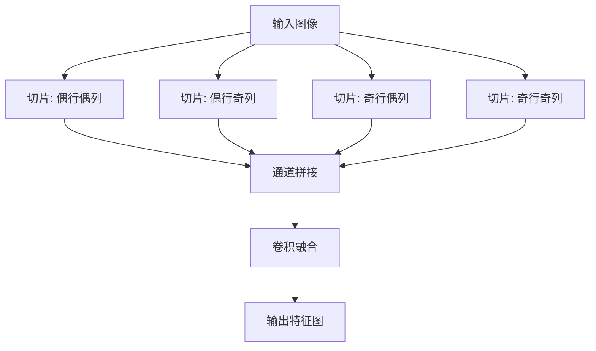

# YOLO原理分析：（YOLOv5）（Focus切片下采样模块）（解决传统步长卷积信息损失问题）

## 前言

YOLOv5 设计了 **Focus** 切片下采样模块，通过对输入图像进行空间切片（slice）操作，将高分辨率信息压缩到通道维度，再进行卷积融合。此前 YOLO 系列使用步长为 2 的卷积或最大池化进行下采样，过程中会丢失部分空间信息。Focus 模块通过"切片—拼接—卷积"的方式，在实现下采样的同时完整保留了原始信息，是 YOLOv5 早期版本的标志性结构创新。

## 背景：前一代的痛点

此前 YOLO 系列的下采样方式：

1. **步长卷积**：使用 stride=2 的卷积进行下采样，卷积过程中会丢失部分信息。
2. **最大池化**：池化操作只保留最大值，丢弃了其余位置的信息。

两种方式都存在信息损失，尤其对小目标而言，下采样过程中的信息丢失会直接导致漏检。

## 原理详述

### Focus 模块的核心操作

Focus 模块的操作分为两步：

**第一步：空间切片（Slice）**

将输入图像按每隔一个像素取样，切分成四张子图：

```text
输入特征图 (4×4×3):
  a1 a2 a3 a4
  b1 b2 b3 b4
  c1 c2 c3 c4
  d1 d2 d3 d4

切片后得到 4 张子图 (每张 2×2×3):
  子图1 (偶数行偶数列):  a1 a3 / c1 c3
  子图2 (偶数行奇数列):  a2 a4 / c2 c4
  子图3 (奇数行偶数列):  b1 b3 / d1 d3
  子图4 (奇数行奇数列):  b2 b4 / d2 d4
```

**第二步：通道拼接**

将 4 张子图在通道维度拼接：
- 每张子图通道数 = 原通道数（3）
- 拼接后通道数 = 4 × 3 = 12
- 空间尺寸变为原来的一半（4×4 → 2×2）

**第三步：卷积融合**

拼接后的特征图经过卷积层（如 32 个卷积核），融合通道信息：
- 输出通道数 = 32
- 空间尺寸 = 2×2

### 下采样效果对比

```text
原始输入: 640×640×3

传统 stride=2 卷积下采样:
  640×640×3 → 320×320×32
  信息在卷积中部分丢失

Focus 切片下采样:
  640×640×3
    → 切片拼接: 320×320×12
    → 卷积融合: 320×320×32
  原始信息完整保留，无丢失
```

### 为什么没有信息损失

切片操作只是重新排列像素位置，不丢弃任何信息。拼接后，原来一个像素的信息被均匀分配到四个子图中，再通过卷积学习如何融合。与步长卷积不同，Focus 不做任何信息取舍。

### 在 YOLOv5 中的位置

Focus 模块位于网络最前端，是输入图像进入网络后的第一个操作：

```text
输入图像 640×640×3
    │
    ▼
Focus 模块 → 320×320×32
    │
    ▼
CSP 主干网络
```

### 后续版本的变化

值得注意的是，在 YOLOv5 的后续版本中，Focus 模块逐渐被普通的步长卷积 + 更大卷积核的组合替代，原因是 Focus 切片操作在某些推理框架上的效率不如直接卷积高。但其设计思想——"无损下采样"——具有重要的创新价值。

## 结构示意

```text
Focus 模块流程:

输入 (640×640×3)
    │
    ├── 切片: 取偶行偶列 → 320×320×3 ──┐
    ├── 切片: 取偶行奇列 → 320×320×3 ──┤
    ├── 切片: 取奇行偶列 → 320×320×3 ──┼─→ concat → 320×320×12
    ├── 切片: 取奇行奇列 → 320×320×3 ──┘
                                              │
                                              ▼
                                    Conv 3×3, 32 filters
                                              │
                                              ▼
                                    输出: 320×320×32
```



## 解决了什么问题

Focus 切片下采样针对传统下采样的信息损失问题做出了以下改进：

1. **信息无损**：切片操作不丢弃任何像素，原始信息完整保留。
2. **保留细节**：小目标的细节信息不会在下采样中丢失，提升小目标检测能力。
3. **高效融合**：卷积学习如何最优融合四个切片的信息，比手动池化更灵活。

## 效果与影响

Focus 模块是 YOLOv5 早期版本的标志性结构，以无损下采样的设计理念提升了特征提取的信息完整性。虽然后续工程优化中 Focus 被更高效的卷积组合替代，但其"切片—拼接—融合"的设计思路为下采样模块提供了新的范式。这一设计也体现了 YOLOv5 工程导向的特点——在保证精度的同时追求效率极致。

---

- 本博客采用生成式AI工具辅助完成撰写
- 本博客所有数据、架构、性能指标均为AI推演生成，不代表生产实践实测结果
- 本博客技术细节仅作为技术探索使用，不构成任何生产实践的指导建议
- 本博客作者不对直接或间接参考本博客开展生产实践所产生的后果负责

