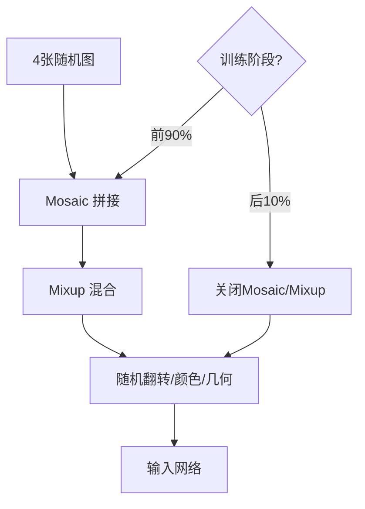

# YOLO原理分析：（YOLOv5）（Mosaic与Mixup组合数据增强）（解决训练数据多样性不足问题）

## 前言

YOLOv5 在 YOLOv4 引入的 **Mosaic** 数据增强基础上，进一步组合了 **Mixup** 增强方法，并设计了训练后期关闭 Mosaic 的策略。此前 YOLOv4 的 Mosaic 虽然效果显著，但单一增强方式在训练后期可能引入过多噪声。YOLOv5 通过 Mosaic + Mixup 组合增强，以及训练后期逐步关闭增强的策略，进一步提升了训练效率与最终精度。这一设计体现了 YOLOv5 对数据增强策略的精细化调度。

## 背景：前一代的痛点

YOLOv4 使用 Mosaic 数据增强，存在以下可改进之处：

1. **增强方式单一**：仅使用四图拼接，增强多样性有限。
2. **全程增强**：训练全程都使用 Mosaic，后期可能引入过多噪声，影响精细收敛。
3. **缺乏混合策略**：没有结合其他互补的增强方法。

## 原理详述

### Mosaic 回顾

Mosaic 将四张图像随机拼接成一张：
- 丰富上下文多样性
- 增加小目标样本
- 正则化效果

### Mixup 增强

Mixup 的核心思想是将两张图像按一定比例混合：

$$
\text{混合图} = \lambda \cdot \text{图A} + (1 - \lambda) \cdot \text{图B}
$$

对应的标签也按同样比例混合：
$$
\text{混合标签} = \lambda \cdot \text{标签A} + (1 - \lambda) \cdot \text{标签B}
$$

其中 $\lambda$ 通常从 Beta 分布中采样。

Mixup 的作用：
- 让模型学习到更平滑的决策边界
- 增强模型对样本扰动的鲁棒性
- 抑制过拟合

### Mosaic + Mixup 组合

YOLOv5 的数据增强流水线中，Mosaic 和 Mixup 是组合使用的：

1. 先做 Mosaic 拼接（四图合一）
2. 再对 Mosaic 结果应用 Mixup（与另一张图混合）

这种组合使数据增强更加多样化，模型见到的样本变化更丰富。

### 训练后期关闭 Mosaic

YOLOv5 的一个重要策略是：**训练最后几个 epoch 关闭 Mosaic 和 Mixup 增强**。

原因：
- Mosaic 引入了大量随机拼接，图像分布偏离真实数据分布
- 训练后期模型需要在真实分布上精细收敛
- 关闭增强后，模型可以学习到更准确的边界

具体策略：
- 训练前 90% 的 epoch：使用 Mosaic + Mixup 等增强
- 训练最后 10% 的 epoch：关闭 Mosaic，让模型在原始数据上收敛

### 其他配套增强

YOLOv5 的数据增强流水线还包括：
- 随机水平翻转
- 颜色空间扰动（HSV 调整）
- 随机缩放与裁剪
- 随机平移

这些增强按概率随机应用，确保每张图的增强组合都是独特的。

## 结构示意

```text
YOLOv5 数据增强流水线:

输入: 4 张随机图像
    │
    ▼
Mosaic 拼接 (四图合一)
    │
    ▼
Mixup 混合 (与另一张图线性叠加)
    │
    ▼
随机翻转 + 颜色扰动 + 几何变换
    │
    ▼
输入网络

训练调度:
  ├─ 前 90% epoch: 完整增强流水线
  └─ 后 10% epoch: 关闭 Mosaic + Mixup
```



## 解决了什么问题

YOLOv5 的组合数据增强策略针对前一代增强方法的局限做出了以下改进：

1. **多样性不足**：Mosaic + Mixup 组合提供了更丰富的样本变化。
2. **训练后期噪声**：后期关闭 Mosaic 让模型在真实分布上精细收敛。
3. **增强调度不精细**：分阶段的增强开关策略，使训练过程更加科学。

## 效果与影响

这种精细化的数据增强调度是 YOLOv5 高精度的重要贡献因素之一。组合增强 + 后期关闭的策略，既充分利用了数据增强的正则化效果，又避免了训练后期的噪声干扰。这一做法后来成为许多检测框架的标准训练策略，体现了"数据增强也是一门精细工程"的理念。

---

- 本博客采用生成式AI工具辅助完成撰写
- 本博客所有数据、架构、性能指标均为AI推演生成，不代表生产实践实测结果
- 本博客技术细节仅作为技术探索使用，不构成任何生产实践的指导建议
- 本博客作者不对直接或间接参考本博客开展生产实践所产生的后果负责

