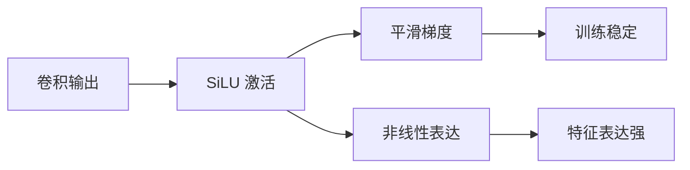

# YOLO原理分析：（YOLOv5）（SiLU激活函数）（解决Mish计算开销与梯度流动问题）

## 前言

YOLOv5 采用 **SiLU**（Sigmoid Linear Unit，又称 Swish）作为激活函数，替代 YOLOv4 的 Mish。SiLU 是一种平滑、非单调的激活函数，具有与 Mish 类似的优良特性，但计算更简单。在保持梯度流动和非线性表达能力的同时，SiLU 的计算开销低于 Mish，适合在网络各处广泛使用。这一选择体现了 YOLOv5 在精度与效率之间的精细权衡。

## 背景：前一代的痛点

YOLOv4 使用 Mish 激活函数，虽然特征表达能力强，但存在以下问题：

1. **计算开销大**：Mish 涉及 $\tanh$ 和 $\ln$ 运算，在深层网络中累积的计算量不小。
2. **全网络使用受限**：由于计算开销，YOLOv4 只在主干网络用 Mish，颈部和检测头仍用 LeakyReLU。
3. **工程效率**：Mish 在不同推理框架上的优化程度不一，影响部署效率。

## 原理详述

### SiLU 函数定义

SiLU（Swish）的数学表达式：

$$
\text{SiLU}(x) = x \cdot \sigma(x)
$$

其中 $\sigma(x)$ 是 sigmoid 函数：

$$
\sigma(x) = \frac{1}{1 + e^{-x}}
$$

展开后：
$$
\text{SiLU}(x) = \frac{x}{1 + e^{-x}}
$$

### SiLU 的特性

**1. 平滑性**

SiLU 在整个实数域上连续可导，没有折角，梯度流动平滑。

**2. 非单调性**

与 ReLU 的单侧线性不同，SiLU 在负值区域有轻微的非单调波动，提供更丰富的非线性表达。

**3. 无上界、有下界**

- 无上界：避免正向饱和
- 有下界（约 -0.28 附近）：提供轻微正则化效果

### 与 Mish 的对比

```text
Mish:
  Mish(x) = x · tanh(softplus(x))
  涉及: tanh + softplus(ln(1+e^x))
  计算量: 较大

SiLU:
  SiLU(x) = x · sigmoid(x)
  涉及: sigmoid(1/(1+e^-x))
  计算量: 较小
```

两者曲线形状相似，都具有平滑、非单调的特性，但 SiLU 计算更简单。

### 与 LeakyReLU 的对比

```text
LeakyReLU:
  正半轴: 线性
  负半轴: 线性 (斜率小)
  折角: x=0 处不可导
  计算: 最简单

SiLU:
  整体: 平滑曲线
  负半轴: 非单调, 轻微波动
  无折角: 处处可导
  计算: 中等
```

### YOLOv5 中的使用

YOLOv5 在整个网络中统一使用 SiLU：
- 主干 CSP 模块
- 颈部 PANet
- 检测头

由于 SiLU 计算量适中，可以在所有位置使用，无需像 YOLOv4 那样区分主干用 Mish、颈部用 LeakyReLU。

## 结构示意

```text
激活函数演进:

LeakyReLU (v1-v3):
  简单高效, 但折角, 线性

Mish (v4):
  平滑, 非单调, 表达强
  但计算开销大

SiLU (v5):
  平滑, 非单调, 表达强
  计算量适中
  → 全网络统一使用
```



## 解决了什么问题

SiLU 激活函数针对 Mish 的计算开销问题做出了以下改进：

1. **计算效率**：SiLU 的计算量低于 Mish，可以在全网络各处使用。
2. **统一激活**：不再需要区分主干用什么、颈部用什么，简化了网络设计。
3. **梯度流动**：平滑连续的特性提供了健康的梯度回传路径。

## 效果与影响

SiLU 是 YOLOv5 工程化优化的代表性选择之一。它在保持 Mish 优良特性的同时降低了计算开销，使整个网络可以统一使用同一激活函数。这种"够用就好"的选择体现了 YOLOv5 务实的工程风格——不追求理论上最强的组件，而是追求精度与效率的最佳平衡。SiLU 后来也成为许多高效网络的默认激活函数。

---

- 本博客采用生成式AI工具辅助完成撰写
- 本博客所有数据、架构、性能指标均为AI推演生成，不代表生产实践实测结果
- 本博客技术细节仅作为技术探索使用，不构成任何生产实践的指导建议
- 本博客作者不对直接或间接参考本博客开展生产实践所产生的后果负责

