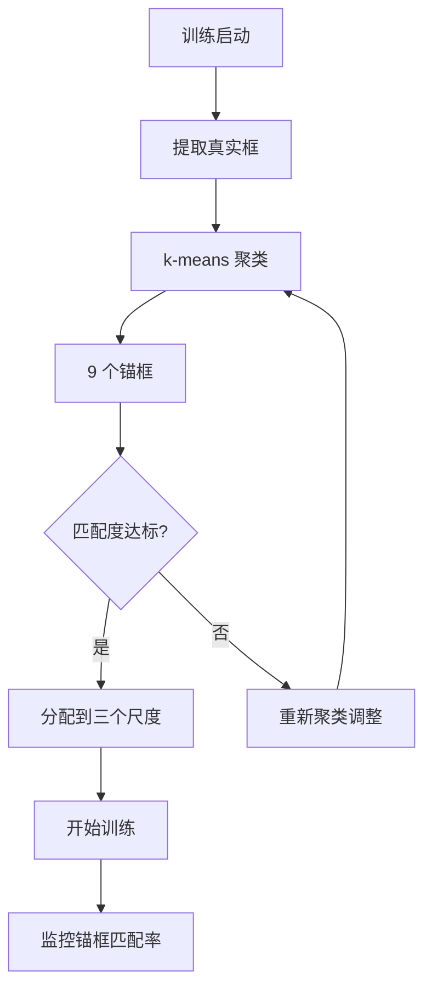

# YOLO原理分析：（YOLOv5）（自适应锚框计算与AutoAnchor）（解决人工设定先验框不匹配问题）

## 前言

YOLOv5 引入了 **AutoAnchor** 自适应锚框计算机制，在训练开始前自动对数据集的真实框做 k-means 聚类，并根据聚类结果自动调整锚框尺寸。此前 YOLOv3、YOLOv4 的锚框是预先在大型数据集上聚类好的固定值，迁移到新数据集时可能不匹配。YOLOv5 的 AutoAnchor 使锚框自动适配当前训练数据集，无需人工调整，是工程化自动化的重要体现。

## 背景：前一代的痛点

此前 YOLO 系列的锚框设置存在以下问题：

1. **人工预设**：锚框尺寸是在特定数据集上聚类得到的固定值，迁移到新数据集时可能不匹配。
2. **需要手动调参**：更换数据集后，需要手动重新聚类或调整锚框，增加了使用门槛。
3. **匹配度不足**：通用锚框在特定数据集上的匹配度不够高，影响检测精度。

## 原理详述

### AutoAnchor 的工作流程

YOLOv5 在训练开始前自动执行以下步骤：

**步骤 1：提取真实框**

从训练集中提取所有标注框的宽高。

**步骤 2：k-means 聚类**

使用基于 **IoU** 距离的 k-means 算法，聚类得到 9 个锚框：

$$
d(\text{box}, \text{centroid}) = 1 - \text{IoU}(\text{box}, \text{centroid})
$$

**步骤 3：评估匹配度**

计算聚类得到的锚框与当前数据集真实框的匹配度：
- 统计有多少真实框能与锚框获得足够高的 IoU
- 计算平均匹配度

**步骤 4：自动调整**

如果匹配度不理想（如低于阈值），自动重新聚类或调整锚框尺寸，直到匹配度达标。

### 自适应锚框的意义

**自动适配数据集**：无论使用什么数据集，锚框都会自动适配该数据集中目标的形状分布。

**减少人工干预**：用户无需关心锚框设置，训练脚本自动完成。

**提升匹配精度**：针对特定数据集优化的锚框，与真实目标的匹配度更高，回归更容易。

### 锚框分配到三个尺度

聚类得到 9 个锚框后，按面积从小到大分配到三个尺度：
- 3 个小锚框 → 高分辨率特征图（小目标）
- 3 个中锚框 → 中分辨率特征图（中目标）
- 3 个大锚框 → 低分辨率特征图（大目标）

这一分配逻辑与 YOLOv3 一致。

### 训练中的自适应调整

除了训练前的聚类，YOLOv5 在训练过程中还会根据正样本匹配情况，动态评估锚框的有效性：
- 如果某些锚框长期匹配不到正样本，可能需要调整
- 训练脚本会自动监控锚框匹配率

### 与手动设置的对比

```text
传统方式:
  预设锚框 → 训练 → 效果不好 → 手动调整 → 重新训练

AutoAnchor:
  自动聚类 → 自动评估 → 自动调整 → 直接训练
```

## 结构示意

```text
训练启动
    │
    ▼
提取数据集所有真实框宽高
    │
    ▼
k-means 聚类 (IoU 距离)
    │
    ▼
得到 9 个锚框
    │
    ├── 小锚框×3 → 高分辨率特征图
    ├── 中锚框×3 → 中分辨率特征图
    └── 大锚框×3 → 低分辨率特征图
    │
    ▼
开始训练
    │
    ▼
训练中监控锚框匹配率
```



## 解决了什么问题

AutoAnchor 自适应锚框计算针对前一代锚框设置的痛点做出了以下改进：

1. **人工预设不匹配**：自动聚类使锚框适配当前数据集，匹配度更高。
2. **手动调参门槛**：自动化流程无需人工干预，降低使用难度。
3. **迁移性差**：更换数据集时锚框自动更新，无需重新设计。

## 效果与影响

AutoAnchor 是 YOLOv5 工程化自动化的代表性特性之一。它将锚框设计从"人工经验"转变为"数据驱动的自动计算"，进一步降低了 YOLO 的使用门槛。这一设计体现了 YOLOv5 一贯的工程导向——在不损失精度的前提下，尽可能自动化、智能化地处理各种训练细节。自适应锚框也成为后续 YOLO 版本的标准配置。


---

- 本博客采用生成式AI工具辅助完成撰写
- 本博客所有数据、架构、性能指标均为AI推演生成，不代表生产实践实测结果
- 本博客技术细节仅作为技术探索使用，不构成任何生产实践的指导建议
- 本博客作者不对直接或间接参考本博客开展生产实践所产生的后果负责

